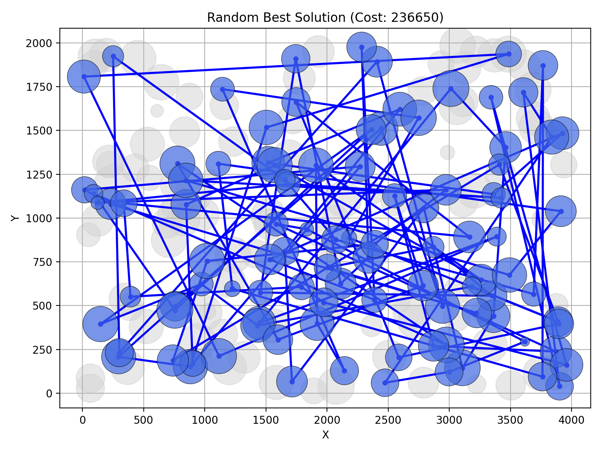
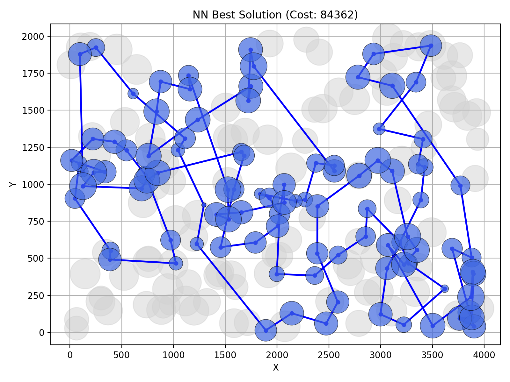
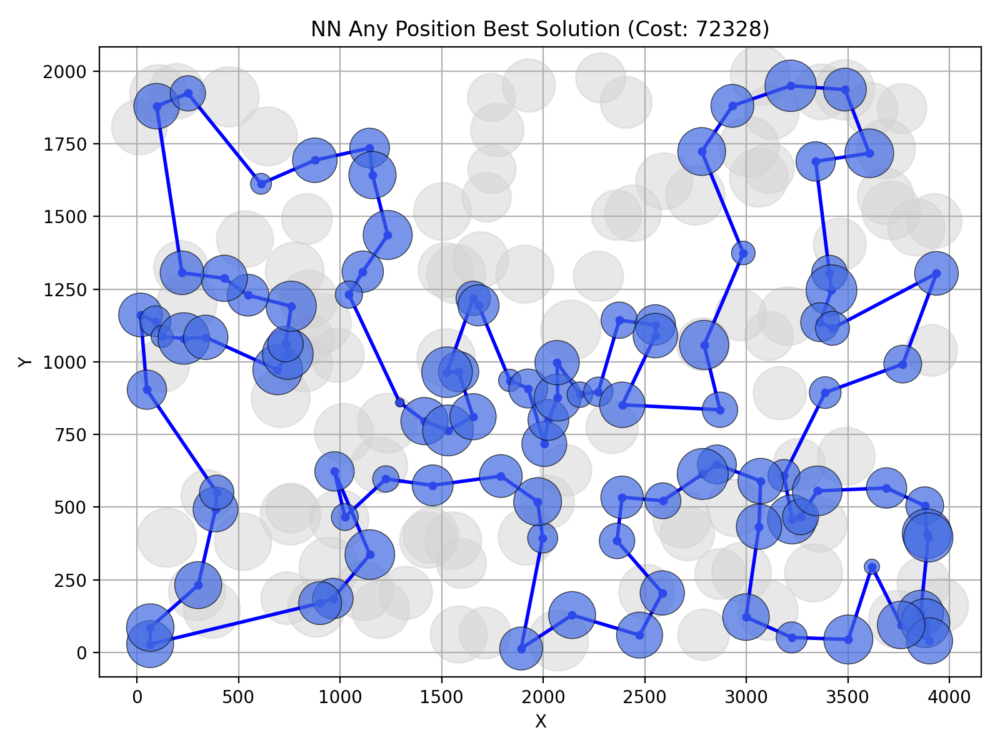
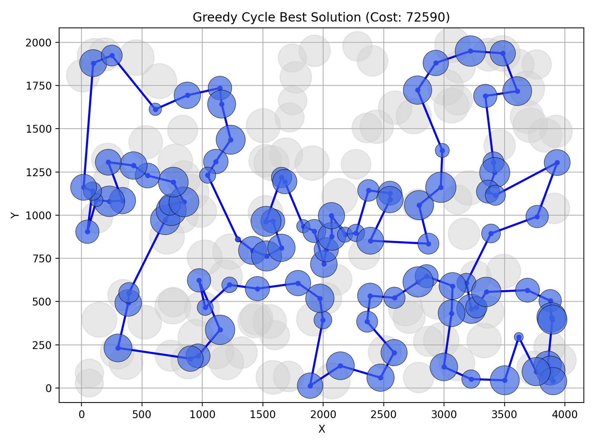
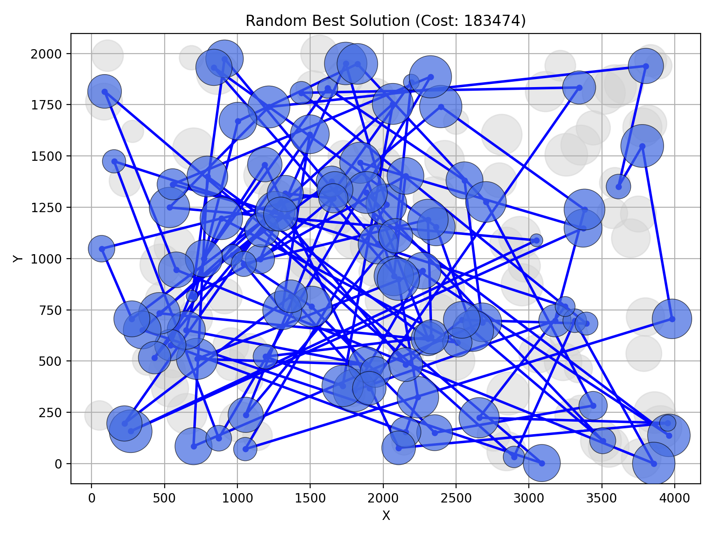
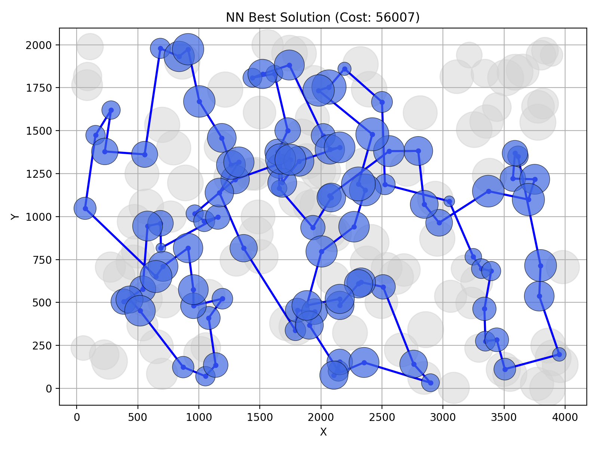
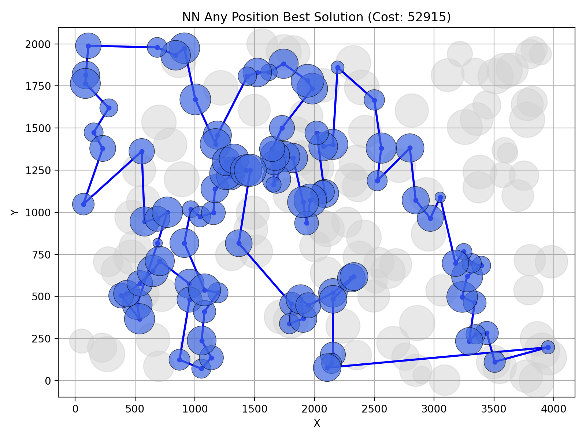
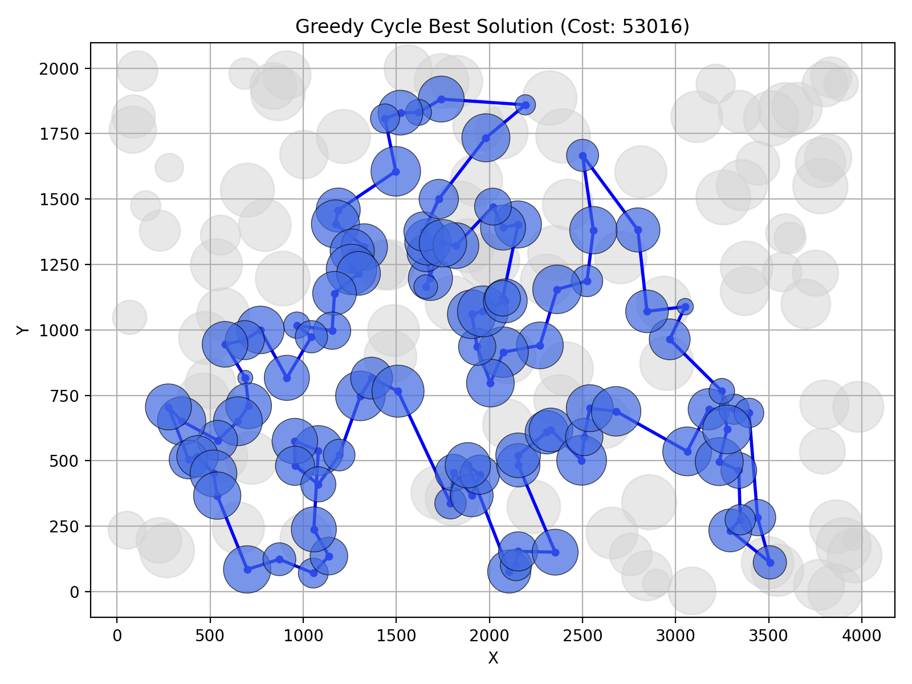

# Greedy heuristic
Adam Mierzwicki 160318, Marcin Perek 160298
## Table of contents
1. Problem description
2. Pseudocode
3. Results
4. Best solutions
5. Best solutions - node indices
6. Information whether the best solutions have been checked with the solution checker.
7. (Link to) the source code
8. Conclusions

## 1. Problem description
We are given three columns of integers with a row for each node. The first two columns contain x and y coordinates of the node positions in a plane. The third column contains node costs. The goal is to select exactly 50% of the nodes (if the number of nodes is odd we round the number of nodes to be selected up) and form a Hamiltonian cycle (closed path) through this set of nodes such that the sum of the total length of the path plus the total cost of the selected nodes is minimized. The distances between nodes are calculated as Euclidean distances rounded mathematically to integer values. 

We implement 4 heuristics to solve this problem:
1. Random - randomly select next node in the path until the required number of nodes is selected.
2. Nearest neighbor - select a starting node and then iteratively select the nearest neighbor to the last node in the path until the required number of nodes is selected.
3. Nearest neighbor (any position) - select a starting node and then iteratively choose a position in the path to insert the nearest neighbors until the required number of nodes is selected.
4. Greedy cycle - select a starting node and its nearest neighbor to form a degenerate cycle. Then iteratively choose next closest point to extend the cycle until the required number of nodes is selected. The next node is inserted in the position that minimizes the total cost of the cycle.

## 2. Pseudocode
### Random
```
repeat
    select random node from remaining nodes
    add node to solution
    update remaining nodes
until solution contains ceil(n/2) nodes
```
### Nearest neighbor
```
select starting node
add starting node to solution
delete starting node from remaining nodes
repeat
    for node in remaining nodes
        calculate distance from last node in path to node
        if distance + node cost < min cost found so far
            update min cost and best node
    add best node to solution
    delete best node from remaining nodes
until solution contains ceil(n/2) nodes
```
### Nearest neighbor (any position)
```
select starting node
add starting node to solution
delete starting node from remaining nodes
repeat
    for position in insert positions in solution
        if position is before first or after last node
            find nearest neighbor from first/last node
        else
            for node in remaining nodes
                calculate distance from node before position to node + distance from node to node after position
                total cost = distance + node cost - distance from node before position to node after position
                if total cost < min cost found so far
                    update min cost and best node and best position
    insert best node into best position in solution
    delete best node from remaining nodes
until solution contains ceil(n/2) nodes
```
### Greedy cycle
```
select starting node
add starting node to solution
delete starting node from remaining nodes
repeat
    for position in insert positions in solution
        for node in remaining nodes
            calculate distance from node before position to node + distance from node to node after position
            total cost = distance + node cost - distance from node before position to node after position
            if total cost < min cost found so far
                update min cost and best node and best position
    insert best node into best position in solution
    delete best node from remaining nodes
until solution contains ceil(n/2) nodes
```

## 3. Results

<table>
    <thead>
        <tr>
            <th rowspan="3" style="text-align:center">Method</th>
            <th colspan="6" style="text-align:center">Instance</th>
        </tr>
        <tr>
            <th colspan="3" style="text-align:center">A</th>
            <th colspan="3" style="text-align:center">B</th>
        </tr>
        <tr>
            <th style="text-align:center">Min</th>
            <th style="text-align:center">Avg</th>
            <th style="text-align:center">Max</th>
            <th style="text-align:center">Min</th>
            <th style="text-align:center">Avg</th>
            <th style="text-align:center">Max</th>
        </tr>
    </thead>
    <tbody>
        <tr>
            <th>Random</th>
            <td>236589</td>
            <td>261052.35</td>
            <td>292354</td>
            <td>182493</td>
            <td>206729.01</td>
            <td>234208</td>
        </tr>
        <tr>
            <th>Nearest neighbor</th>
            <td>84362</td>
            <td>87476.63</td>
            <td>90075</td>
            <td>56007</td>
            <td>59397.335</td>
            <td>63166</td>
        </tr>
        <tr>
            <th>Nearest neighbor (any position)</th>
            <td>72328</td>
            <td>74306.53</td>
            <td>77022</td>
            <td>52915</td>
            <td>59476.225</td>
            <td>66164</td>
        </tr>
        <tr>
            <th>Greedy cycle</th>
            <td>72590</td>
            <td>73758.44</td>
            <td>75345</td>
            <td>53016</td>
            <td>59832.475</td>
            <td>63736</td>
        </tr>
    </tbody>
</table>

## 4. Best solutions
### Instance A:
Random:

Nearest neighbor:


Nearest neighbor (any position):


Greedy cycle:


### Instance B:
Random: 


Nearest neighbor:


Nearest neighbor (any position):


Greedy cycle:


## 5. Best solutions - node indices
### Instance A:
Random:
```
29, 46, 2, 131, 16, 152, 149, 189, 140, 44, 8, 37, 61, 27, 30, 185, 178, 146, 1, 43, 106, 153, 176, 54, 173, 174, 5, 114, 108, 38, 88, 122, 13, 96, 157, 129, 137, 10, 145, 4, 104, 116, 59, 124, 70, 22, 35, 86, 154, 34, 99, 175, 117, 121, 20, 45, 71, 55, 75, 24, 25, 171, 58, 191, 76, 41, 103, 181, 62, 141, 95, 82, 187, 120, 109, 74, 65, 148, 163, 63, 67, 165, 182, 164, 51, 94, 136, 135, 39, 139, 98, 158, 197, 66, 128, 169, 127, 85, 32, 160
```
Nearest neighbor:
```
54, 9, 33, 36, 177, 67, 144, 53, 135, 58, 134, 176, 174, 106, 89, 107, 57, 182, 151, 93, 50, 3, 1, 164, 178, 29, 136, 186, 184, 47, 159, 130, 153, 78, 88, 193, 170, 146, 75, 64, 150, 42, 113, 43, 85, 142, 8, 131, 84, 158, 192, 181, 114, 141, 180, 132, 76, 80, 48, 31, 63, 149, 168, 97, 127, 187, 30, 123, 152, 108, 60, 116, 49, 11, 119, 160, 83, 90, 51, 16, 35, 87, 45, 140, 52, 179, 185, 28, 102, 156, 157, 71, 91, 38, 100, 4, 112, 139, 115, 5
```
Nearest neighbor (any position):
```
104, 129, 69, 127, 97, 168, 116, 149, 63, 11, 49, 160, 83, 123, 100, 152, 108, 60, 31, 48, 80, 91, 157, 71, 4, 76, 132, 180, 28, 102, 185, 35, 156, 51, 16, 67, 144, 140, 53, 179, 52, 177, 36, 33, 9, 54, 131, 174, 8, 164, 186, 136, 163, 29, 101, 178, 1, 169, 3, 50, 147, 47, 93, 106, 42, 89, 113, 130, 159, 146, 170, 153, 193, 78, 88, 107, 64, 57, 182, 151, 150, 176, 72, 134, 84, 58, 158, 192, 181, 114, 135, 73, 45, 87, 141, 187, 30, 189, 2, 171
```
Greedy cycle:
```
80, 91, 157, 71, 4, 76, 132, 180, 28, 102, 185, 35, 156, 51, 16, 67, 144, 140, 53, 179, 52, 177, 36, 33, 9, 54, 131, 174, 8, 142, 164, 186, 136, 163, 29, 101, 178, 1, 169, 3, 50, 147, 47, 93, 106, 42, 89, 113, 130, 159, 146, 170, 153, 193, 78, 88, 107, 64, 57, 182, 151, 150, 176, 72, 134, 84, 58, 158, 192, 181, 114, 135, 73, 45, 87, 141, 187, 30, 189, 2, 171, 69, 127, 97, 160, 83, 123, 90, 100, 152, 108, 60, 49, 11, 63, 168, 149, 116, 31, 48
```

### Instance B:

Random:
```
157, 28, 130, 19, 22, 134, 18, 9, 186, 139, 99, 116, 21, 111, 172, 15, 150, 3, 7, 126, 105, 143, 184, 124, 65, 145, 166, 168, 138, 50, 178, 140, 69, 97, 36, 123, 64, 76, 40, 44, 66, 106, 60, 110, 115, 74, 73, 71, 72, 91, 160, 68, 56, 20, 39, 148, 147, 109, 43, 57, 79, 38, 62, 175, 63, 49, 37, 25, 154, 89, 182, 179, 161, 153, 185, 34, 156, 88, 27, 192, 136, 87, 46, 164, 196, 173, 162, 104, 0, 191, 188, 41, 55, 11, 93, 14, 6, 152, 181, 24
```
Nearest neighbor:
```
32, 89, 57, 76, 54, 127, 129, 90, 153, 20, 14, 2, 110, 118, 56, 114, 196, 10, 148, 143, 78, 192, 162, 104, 185, 184, 3, 151, 69, 172, 133, 120, 96, 121, 198, 48, 72, 46, 86, 117, 160, 136, 8, 21, 154, 140, 47, 170, 125, 177, 6, 132, 29, 197, 175, 134, 45, 60, 40, 71, 155, 97, 115, 180, 65, 28, 149, 145, 158, 116, 147, 42, 50, 130, 30, 183, 38, 64, 85, 59, 167, 51, 87, 179, 82, 88, 171, 99, 67, 24, 34, 181, 152, 73, 98, 27, 135, 75, 79, 156
```
Nearest neighbor (any position):
```
110, 2, 14, 20, 74, 153, 182, 52, 90, 129, 127, 80, 54, 192, 162, 104, 76, 185, 57, 89, 86, 46, 72, 3, 184, 173, 151, 122, 117, 8, 160, 69, 172, 136, 133, 120, 156, 43, 48, 96, 198, 121, 130, 191, 50, 42, 147, 116, 37, 146, 13, 149, 28, 145, 65, 158, 177, 125, 26, 170, 197, 36, 132, 29, 6, 180, 115, 155, 71, 175, 134, 45, 157, 60, 40, 141, 97, 154, 140, 47, 38, 21, 176, 30, 183, 189, 168, 64, 59, 85, 51, 73, 167, 152, 34, 24, 181, 179, 87, 82
```
Greedy cycle:
```
160, 172, 136, 133, 120, 156, 89, 48, 96, 198, 121, 63, 130, 191, 183, 30, 176, 21, 38, 47, 154, 140, 97, 26, 125, 177, 170, 115, 180, 6, 103, 178, 132, 29, 197, 36, 62, 175, 134, 45, 157, 141, 155, 71, 60, 40, 33, 64, 49, 85, 59, 51, 167, 73, 82, 87, 179, 88, 181, 152, 34, 24, 31, 67, 66, 84, 150, 80, 129, 90, 14, 2, 74, 20, 153, 182, 52, 127, 192, 54, 162, 104, 57, 185, 76, 135, 27, 111, 98, 151, 122, 173, 3, 184, 86, 46, 72, 117, 8, 69
```

## 6. Solution verification
All solutions have been verified with the solution checker and the experiment results match the results from the checker.

## 7. Source code
Source code is available on 
[Github](https://github.com/adammierzwicki/evolutionary-computation/tree/main/lab1).

## 8. Conclusions
As expected random heuristic performed the worst in all cases. Other methods performed comparably to each other, except for standard nearest neighbor which performed a bit worse than the other two heuristics on instance A.

For instance A, nearest neighbor (any position) heuristic found the best solution but on average it performed worse than cycle greedy heuristic. For instance B, nearest neighbor (any position) also found the best solution but on average standard nearest neighbor performed the best. This shows that the performance of heuristics is highly dependent on the instance and it is not possible to determine which heuristic will perform best on a given instance without testing them all.

Code was written in Python which resulted in longer execution times for nearest neighbor (any position) and greedy cycle heuristics. Random and standard nearest neighbor performed almost instantaneously, while the other two took around 20-30 seconds for the 200 nodes given in the instances.