# Greedy regret heuristics
Adam Mierzwicki 160318, Marcin Perek 160298
## Table of contents
1. Problem description
2. Pseudocode 
3. Results
4. Best solutions
5. Best solutions - node indices
6. Information whether the best solutions have been checked with the solution checker.
7. (Link to) the source code
8. Conclusions

## 1. Problem description
We are given three columns of integers with a row for each node. The first two columns contain x and y coordinates of the node positions in a plane. The third column contains node costs. The goal is to select exactly 50% of the nodes (if the number of nodes is odd we round the number of nodes to be selected up) and form a Hamiltonian cycle (closed path) through this set of nodes such that the sum of the total length of the path plus the total cost of the selected nodes is minimized. The distances between nodes are calculated as Euclidean distances rounded mathematically to integer values. 

We implement four heuristics based on 2-regret:
1. **Nearest neighbor (any position) 2-regret**: start from one node. In each iteration, for every remaining node compute the best and second-best insertion position in the current path (including before the first, after the last node and in the middle). Insert the node with the largest regret (second best - best) at its best position.
2. **Greedy cycle 2-regret**: start from one node and its cheapest neighbor, forming a two-node cycle. Then repeat the 2-regret selection from method 1, but nodes can be inserted into any edge of the cycle, including the closing edge between the last and first node, instead of only into the path or at its ends.
3. **Nearest neighbor (any position) weighted 2-regret**: as in 1, but the node is chosen by maximizing `w_regret * regret - w_obj * best_insertion_cost`.
4. **Greedy cycle weighted 2-regret**: as in 2, but the node is chosen by maximizing `w_regret * regret - w_obj * best_insertion_cost`.

<div style="page-break-after: always;"></div>

## 2. Pseudocode

### Nearest neighbor (any position) 2-regret
```
select starting node
add starting node to solution
delete starting node from remaining nodes
repeat
    for node in remaining nodes
        initialize best cost, second best cost to infinity
        for position in insert positions in solution (before first, between nodes, after last)
            if position is before first / after last node
                distance = distance from node to first/last node
            else
                distance = distance from node before position to node + distance from node to node after position
                           - distance from node before position to node after position
            total cost = distance + node cost
            record and update best cost, second best cost and best position for this node
        regret = second best cost - best cost
    choose node with the highest regret (on ties choose the one with the lowest best insertion cost)
    insert chosen node into its best position in solution
    delete chosen node from remaining nodes
until solution contains ceil(n/2) nodes
```

<div style="page-break-after: always;"></div>

### Greedy cycle 2-regret
```
select starting node
add starting node to solution
delete starting node from remaining nodes
find node with the lowest (distance from starting node + node cost) among remaining nodes
add it to solution
delete it from remaining nodes
repeat
    for node in remaining nodes
        initialize best cost and second best cost to infinity
        for position in insert positions in solution (between nodes, including closing edge between last and first node)
            distance = distance from node before position to node + distance from node to node after position
                       - distance from node before position to node after position
            total cost = distance + node cost
            record and update best cost, second best cost and best position for this node
        regret = second best cost - best cost
    choose node with the highest regret (on ties choose the one with the lowest best insertion cost)
    insert chosen node into its best position in solution
    delete chosen node from remaining nodes
until solution contains ceil(n/2) nodes
```

<div style="page-break-after: always;"></div>

### Nearest neighbor (any position) weighted 2-regret
```
select starting node
add starting node to solution
delete starting node from remaining nodes
repeat
    for node in remaining nodes
        initialize best cost and second best cost to infinity
        for position in insert positions in solution (before first, between nodes, after last)
            if position is before first / after last node
                distance = distance from node to first/last node
            else
                distance = distance from node before position to node + distance from node to node after position
                           - distance from node before position to node after position
            total cost = distance + node cost
            record and update best cost, second best cost and best position for this node
        regret = second best cost - best cost
        score = w_regret * regret - w_obj * best cost
    choose node with the highest score
    insert chosen node into its best position in solution
    delete chosen node from remaining nodes
until solution contains ceil(n/2) nodes
```

<div style="page-break-after: always;"></div>

### Greedy cycle weighted 2-regret
```
select starting node
add starting node to solution
delete starting node from remaining nodes
find node with the lowest (distance from starting node + node cost) among remaining nodes
add it to solution
delete it from remaining nodes
repeat
    for node in remaining nodes
        initialize best cost and second best cost to infinity
        for position in insert positions in solution (between nodes, including closing edge between last and first node)
            distance = distance from node before position to node + distance from node to node after position
                       - distance from node before position to node after position
            total cost = distance + node cost
            record and update best cost, second best cost and best position for this node
        regret = second best cost - best cost
        score = w_regret * regret - w_obj * best cost
    choose node with the highest score
    insert chosen node into its best position in solution
    delete chosen node from remaining nodes
until solution contains ceil(n/2) nodes
```

<div style="page-break-after: always;"></div>

## 3. Results
<table>
    <thead>
        <tr>
            <th rowspan="3" style="text-align:center">Method</th>
            <th colspan="6" style="text-align:center">Instance</th>
        </tr>
        <tr>
            <th colspan="3" style="text-align:center">A</th>
            <th colspan="3" style="text-align:center">B</th>
        </tr>
        <tr>
            <th style="text-align:center">Min</th>
            <th style="text-align:center">Avg</th>
            <th style="text-align:center">Max</th>
            <th style="text-align:center">Min</th>
            <th style="text-align:center">Avg</th>
            <th style="text-align:center">Max</th>
        </tr>
    </thead>
    <tbody>
        <tr>
            <th>(lab1) Random</th>
            <td>236589</td>
            <td>261052.35</td>
            <td>292354</td>
            <td>182493</td>
            <td>206729.01</td>
            <td>234208</td>
        </tr>
        <tr>
            <th>(lab1) Nearest neighbor</th>
            <td>84362</td>
            <td>87476.63</td>
            <td>90075</td>
            <td>56007</td>
            <td>59397.335</td>
            <td>63166</td>
        </tr>
        <tr>
            <th>(lab1) Nearest neighbor (any position)</th>
            <td>72328</td>
            <td>74306.53</td>
            <td>77022</td>
            <td>52915</td>
            <td>59476.225</td>
            <td>66164</td>
        </tr>
        <tr>
            <th>(lab1) Greedy cycle</th>
            <td>72590</td>
            <td>73758.44</td>
            <td><b>75345</b></td>
            <td>53016</td>
            <td>59832.475</td>
            <td>63736</td>
        </tr>
        <tr>
            <th>Nearest neighbor (any position) 2-regret</th>
            <td>110950</td>
            <td>121360</td>
            <td>135771</td>
            <td>68761</td>
            <td>73649.8</td>
            <td>79756</td>
        </tr>
        <tr>
            <th>Greedy cycle 2-regret</th>
            <td>110303</td>
            <td>120368</td>
            <td>128089</td>
            <td>67078</td>
            <td>72368</td>
            <td>76382</td>
        </tr>
        <tr>
            <th>Nearest neighbor (any position) weighted 2-regret</th>
            <td>72419</td>
            <td>75561.2</td>
            <td>78504</td>
            <td><b>50485</b></td>
            <td><b>55698.3</b></td>
            <td><b>61406</b></td>
        </tr>
        <tr>
            <th>Greedy cycle weighted 2-regret</th>
            <td><b>72011</b></td>
            <td><b>73349.6</b></td>
            <td>75532</td>
            <td>52906</td>
            <td>57751.4</td>
            <td>63326</td>
        </tr>
    </tbody>
</table>

---

### Regret vs. objective weight comparison
<table>
    <tr>
        <td align="center">
            Instance A<br>
            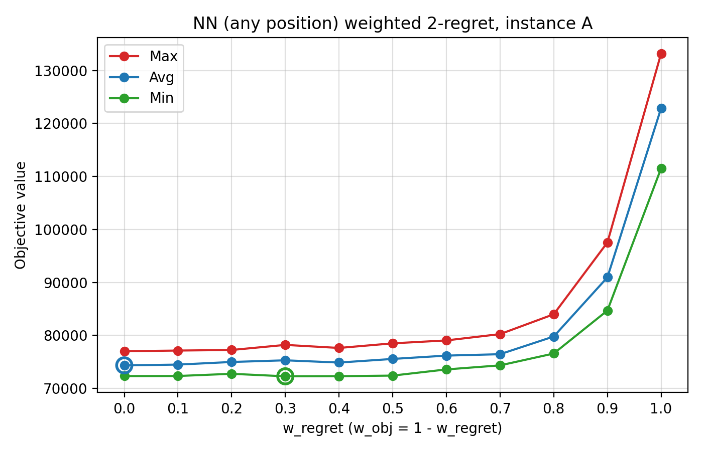
        </td>
        <td align="center">
            Instance B<br>
            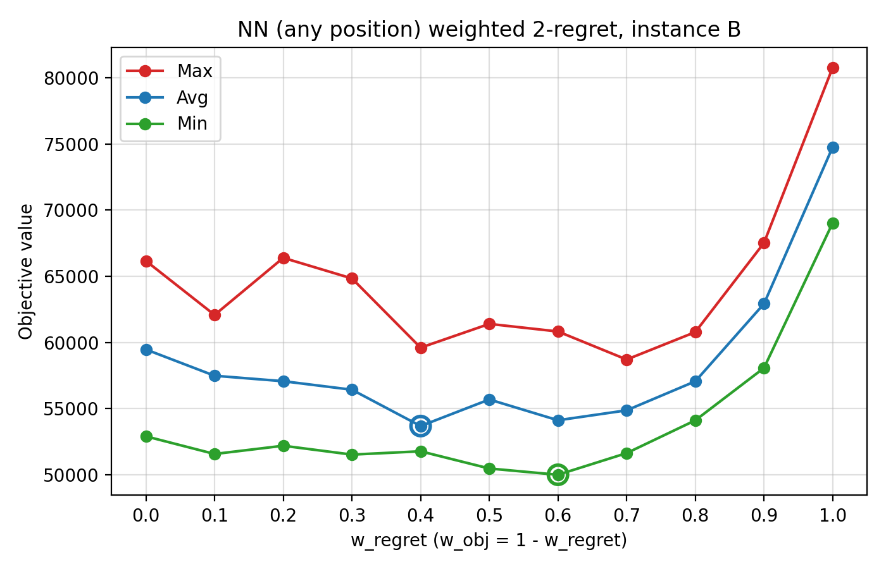
        </td>
    </tr>
    <tr>
        <td align="center">
            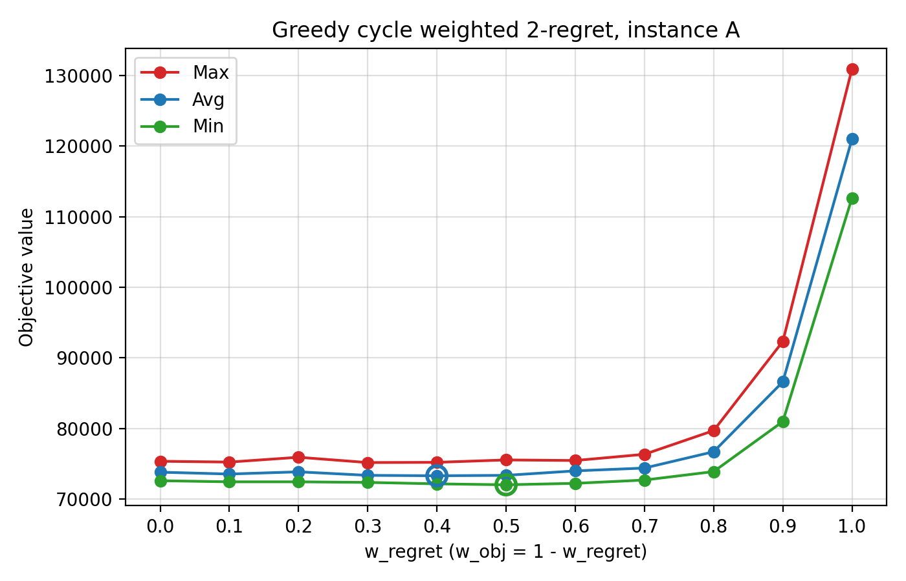
        </td>
        <td align="center">
            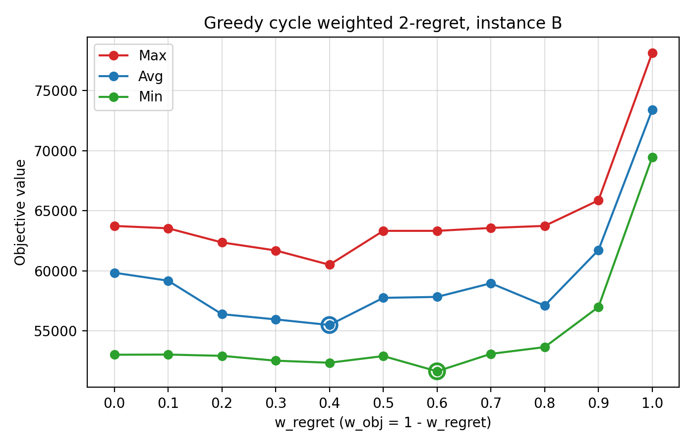
        </td>
    </tr>
</table>

### NN (any position) weighted 2-regret
<table>
    <thead>
        <tr>
            <th rowspan="3" style="text-align:center">w_regret</th>
            <th rowspan="3" style="text-align:center">w_obj</th>
            <th colspan="6" style="text-align:center">Instance</th>
        </tr>
        <tr>
            <th colspan="3" style="text-align:center">A</th>
            <th colspan="3" style="text-align:center">B</th>
        </tr>
        <tr>
            <th style="text-align:center">Min</th>
            <th style="text-align:center">Avg</th>
            <th style="text-align:center">Max</th>
            <th style="text-align:center">Min</th>
            <th style="text-align:center">Avg</th>
            <th style="text-align:center">Max</th>
        </tr>
    </thead>
    <tbody>
        <tr><th>0.0</th><td>1.0</td><td>72328</td><td><b>74347.0</b></td><td><b>77022</b></td><td>52915</td><td>59475.5</td><td>66164</td></tr>
        <tr><th>0.1</th><td>0.9</td><td>72343</td><td>74494.8</td><td>77143</td><td>51581</td><td>57490.0</td><td>62082</td></tr>
        <tr><th>0.2</th><td>0.8</td><td>72758</td><td>74988.9</td><td>77251</td><td>52203</td><td>57078.3</td><td>66396</td></tr>
        <tr><th>0.3</th><td>0.7</td><td><b>72283</b></td><td>75303.1</td><td>78210</td><td>51534</td><td>56435.3</td><td>64840</td></tr>
        <tr><th>0.4</th><td>0.6</td><td>72306</td><td>74879.4</td><td>77634</td><td>51784</td><td><b>53690.8</b></td><td>59611</td></tr>
        <tr><th>0.5</th><td>0.5</td><td>72419</td><td>75561.2</td><td>78504</td><td>50485</td><td>55698.3</td><td>61406</td></tr>
        <tr><th>0.6</th><td>0.4</td><td>73581</td><td>76189.1</td><td>79055</td><td><b>50011</b></td><td>54127.3</td><td>60833</td></tr>
        <tr><th>0.7</th><td>0.3</td><td>74348</td><td>76454.1</td><td>80246</td><td>51646</td><td>54878.5</td><td><b>58715</b></td></tr>
        <tr><th>0.8</th><td>0.2</td><td>76584</td><td>79795.0</td><td>83988</td><td>54123</td><td>57070.4</td><td>60790</td></tr>
        <tr><th>0.9</th><td>0.1</td><td>84697</td><td>90958.7</td><td>97543</td><td>58081</td><td>62930.0</td><td>67528</td></tr>
        <tr><th>1.0</th><td>0.0</td><td>111527</td><td>122860.7</td><td>133181</td><td>69032</td><td>74763.4</td><td>80767</td></tr>
    </tbody>
</table>

### Greedy cycle weighted 2-regret
<table>
    <thead>
        <tr>
            <th rowspan="3" style="text-align:center">w_regret</th>
            <th rowspan="3" style="text-align:center">w_obj</th>
            <th colspan="6" style="text-align:center">Instance</th>
        </tr>
        <tr>
            <th colspan="3" style="text-align:center">A</th>
            <th colspan="3" style="text-align:center">B</th>
        </tr>
        <tr>
            <th style="text-align:center">Min</th>
            <th style="text-align:center">Avg</th>
            <th style="text-align:center">Max</th>
            <th style="text-align:center">Min</th>
            <th style="text-align:center">Avg</th>
            <th style="text-align:center">Max</th>
        </tr>
    </thead>
    <tbody>
        <tr><th>0.0</th><td>1.0</td><td>72590</td><td>73796.8</td><td>75345</td><td>53016</td><td>59842.0</td><td>63736</td></tr>
        <tr><th>0.1</th><td>0.9</td><td>72430</td><td>73533.9</td><td>75229</td><td>53031</td><td>59177.9</td><td>63541</td></tr>
        <tr><th>0.2</th><td>0.8</td><td>72430</td><td>73846.1</td><td>75911</td><td>52924</td><td>56393.9</td><td>62364</td></tr>
        <tr><th>0.3</th><td>0.7</td><td>72347</td><td>73349.3</td><td><b>75162</b></td><td>52522</td><td>55957.4</td><td>61695</td></tr>
        <tr><th>0.4</th><td>0.6</td><td>72144</td><td><b>73290.4</b></td><td>75193</td><td>52351</td><td><b>55490.5</b></td><td><b>60504</b></td></tr>
        <tr><th>0.5</th><td>0.5</td><td><b>72011</b></td><td>73349.6</td><td>75532</td><td>52906</td><td>57751.4</td><td>63326</td></tr>
        <tr><th>0.6</th><td>0.4</td><td>72217</td><td>73981.8</td><td>75451</td><td><b>51637</b></td><td>57828.8</td><td>63327</td></tr>
        <tr><th>0.7</th><td>0.3</td><td>72682</td><td>74381.5</td><td>76332</td><td>53089</td><td>58963.8</td><td>63568</td></tr>
        <tr><th>0.8</th><td>0.2</td><td>73880</td><td>76695.0</td><td>79689</td><td>53651</td><td>57107.3</td><td>63740</td></tr>
        <tr><th>0.9</th><td>0.1</td><td>80972</td><td>86597.0</td><td>92323</td><td>56986</td><td>61719.8</td><td>65864</td></tr>
        <tr><th>1.0</th><td>0.0</td><td>112654</td><td>121007.2</td><td>130924</td><td>69455</td><td>73403.4</td><td>78142</td></tr>
    </tbody>
</table>

## 4. Best solutions
### Instance A
<table>
    <tr>
        <td align="center">
            NN (any position) 2-regret<br>
            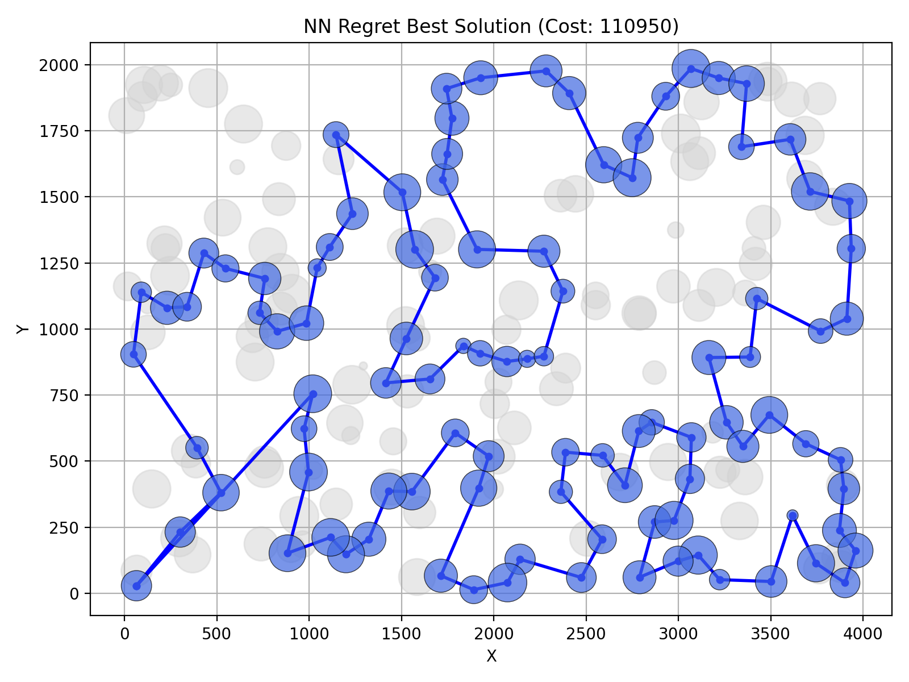
        </td>
        <td align="center">
            Greedy cycle 2-regret<br>
            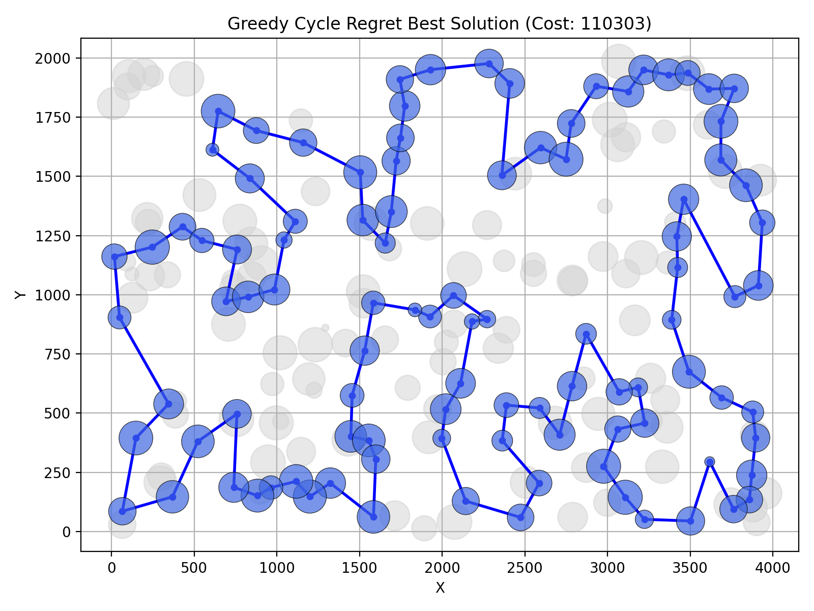
        </td>
    </tr>
    <tr>
        <td align="center">
            NN (any position) weighted 2-regret<br>
            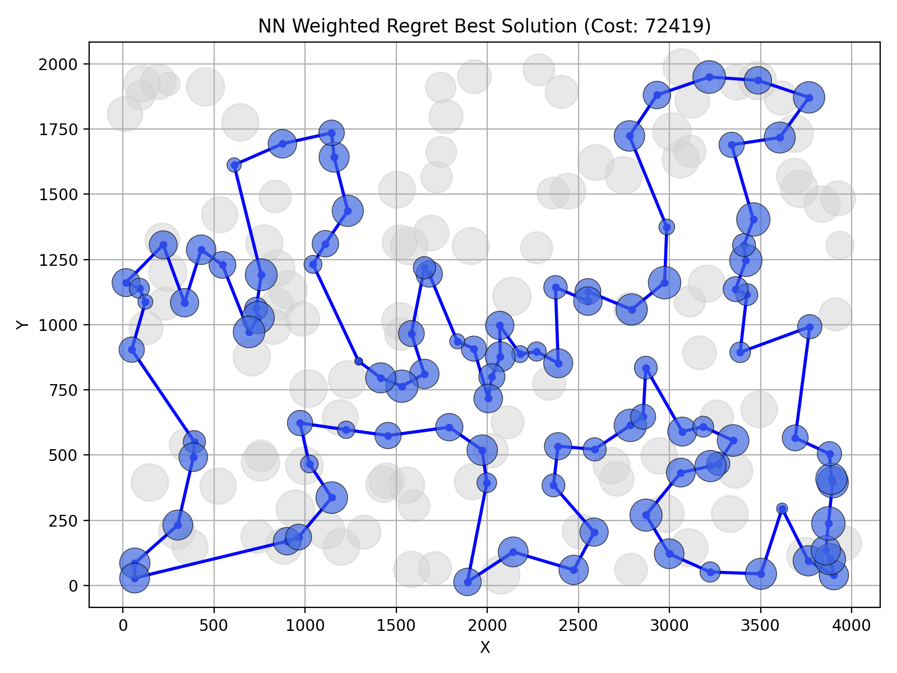
        </td>
        <td align="center">
            Greedy cycle weighted 2-regret<br>
            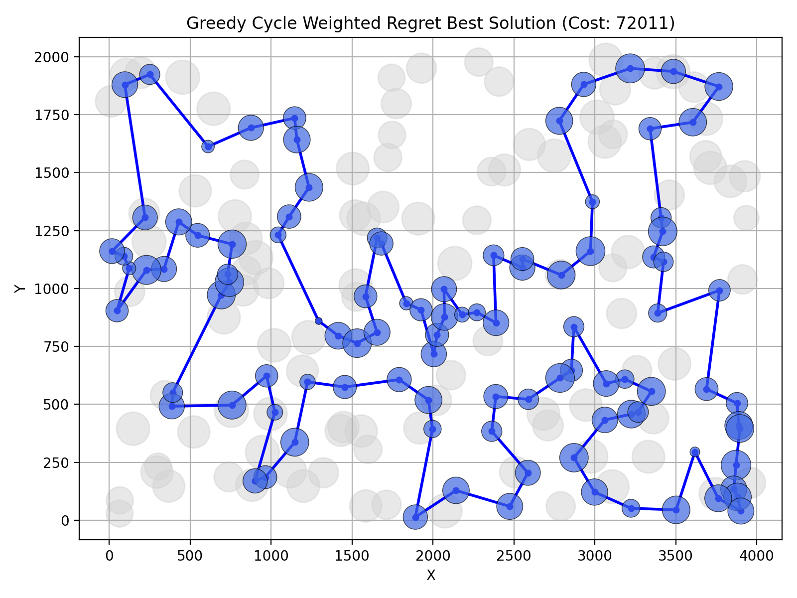
        </td>
    </tr>
</table>

<div style="page-break-after: always;"></div>

### Instance B
<table>
    <tr>
        <td align="center">
            NN (any position) 2-regret<br>
            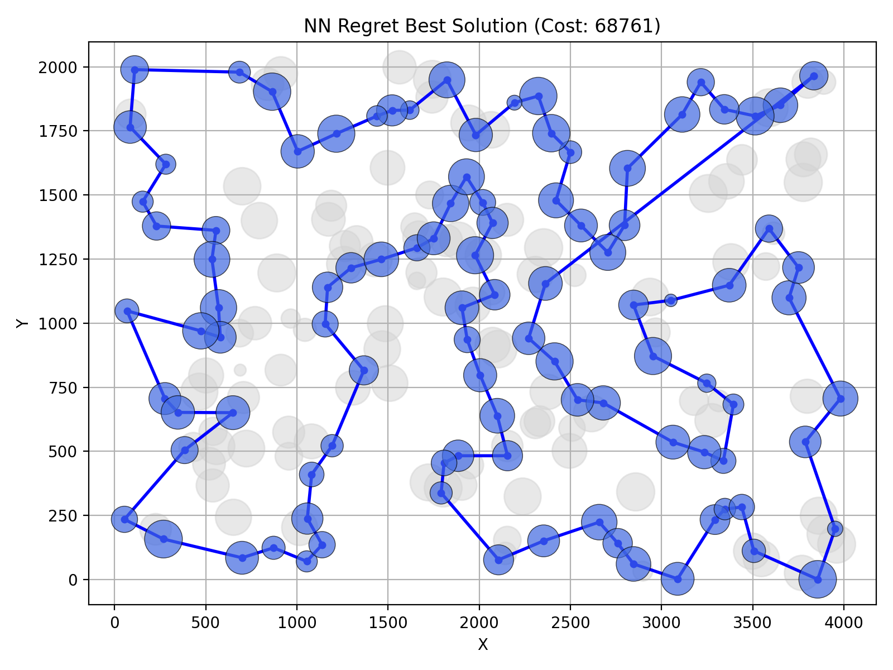
        </td>
        <td align="center">
            Greedy cycle 2-regret<br>
            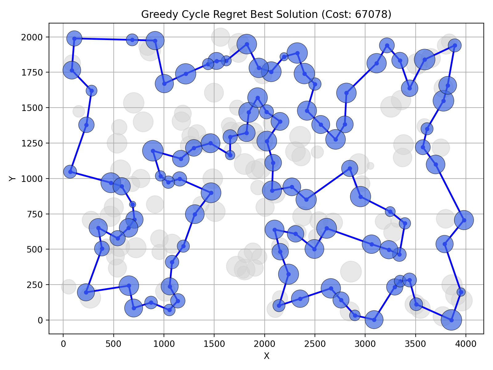
        </td>
    </tr>
    <tr>
        <td align="center">
            NN (any position) weighted 2-regret<br>
            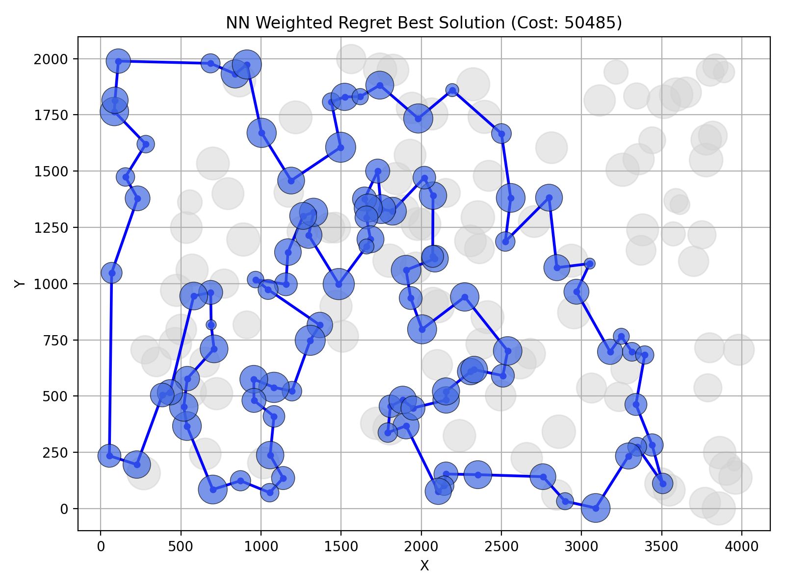
        </td>
        <td align="center">
            Greedy cycle weighted 2-regret<br>
            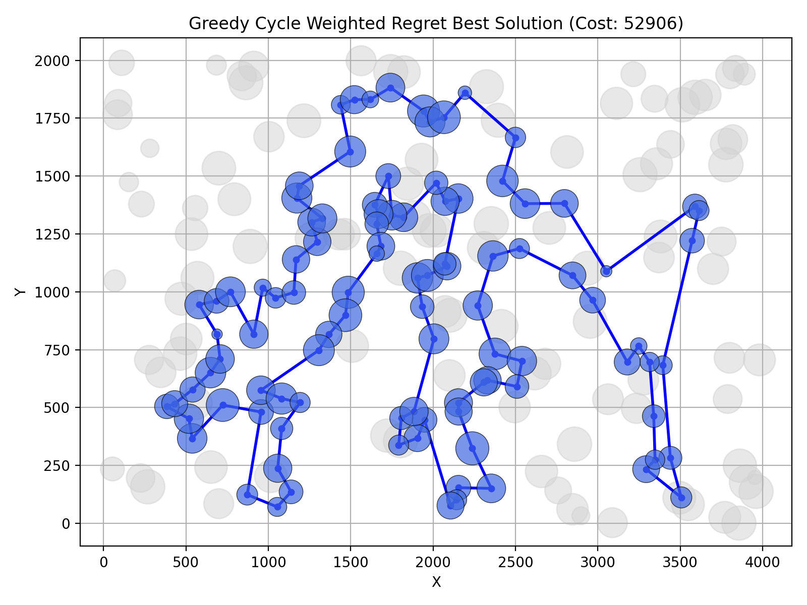
        </td>
    </tr>
</table>

<div style="page-break-after: always;"></div>

## 5. Best solutions - node indices
### Instance A:
Nearest neighbor (any position) 2-regret:
```
104, 69, 120, 97, 168, 149, 11, 49, 108, 152, 100, 123, 148, 162, 132, 76, 4, 157, 18, 173, 16, 156, 28, 185, 67, 144, 179, 177, 36, 33, 143, 190, 139, 112, 5, 115, 175, 39, 154, 34, 109, 186, 136, 197, 163, 19, 178, 101, 155, 21, 147, 37, 47, 50, 93, 81, 43, 113, 117, 130, 159, 170, 75, 26, 78, 122, 107, 64, 57, 105, 182, 111, 138, 165, 151, 150, 176, 72, 65, 134, 84, 58, 158, 192, 181, 118, 114, 25, 121, 73, 45, 70, 96, 10, 183, 166, 32, 40, 30, 23
```
Greedy cycle 2-regret:
```
36, 52, 144, 67, 35, 102, 87, 27, 70, 98, 22, 10, 183, 166, 2, 32, 92, 161, 120, 110, 129, 188, 95, 168, 116, 167, 108, 152, 100, 160, 148, 162, 132, 76, 38, 80, 137, 91, 71, 18, 196, 51, 133, 139, 112, 5, 115, 175, 39, 154, 62, 34, 109, 186, 136, 24, 163, 19, 29, 17, 55, 86, 46, 6, 147, 37, 47, 59, 169, 50, 93, 117, 130, 159, 170, 75, 153, 88, 107, 64, 57, 105, 165, 151, 42, 106, 150, 174, 72, 65, 134, 84, 58, 158, 192, 181, 135, 61, 41, 177
```
Nearest neighbor (any position) weighted 2-regret:
```
171, 2, 189, 187, 30, 141, 87, 45, 73, 135, 114, 181, 192, 158, 58, 84, 134, 72, 176, 174, 150, 106, 113, 89, 42, 151, 138, 182, 57, 64, 107, 88, 78, 193, 153, 75, 170, 146, 159, 130, 47, 93, 50, 3, 169, 1, 59, 178, 101, 55, 29, 163, 136, 186, 164, 142, 8, 9, 54, 33, 131, 36, 177, 52, 179, 53, 140, 144, 67, 16, 51, 35, 185, 102, 28, 180, 132, 76, 4, 71, 157, 91, 80, 100, 123, 83, 160, 152, 108, 49, 60, 116, 149, 63, 168, 97, 127, 69, 129, 104
```
Greedy cycle weighted 2-regret:
```
80, 91, 157, 71, 4, 76, 132, 180, 28, 102, 185, 35, 51, 16, 67, 144, 140, 53, 179, 52, 177, 36, 131, 33, 54, 9, 8, 142, 164, 186, 136, 163, 29, 55, 101, 178, 1, 169, 3, 50, 93, 47, 130, 159, 146, 170, 75, 153, 193, 78, 88, 107, 64, 57, 182, 138, 151, 42, 89, 113, 106, 150, 174, 176, 72, 134, 84, 58, 158, 192, 181, 114, 135, 73, 45, 87, 141, 189, 2, 171, 187, 30, 161, 127, 97, 160, 83, 123, 100, 152, 108, 49, 11, 168, 63, 149, 116, 60, 31, 48
```

### Instance B:

Nearest neighbor (any position) 2-regret:
```
94, 169, 199, 70, 190, 194, 77, 104, 144, 185, 79, 57, 83, 44, 89, 156, 164, 96, 198, 121, 195, 50, 7, 116, 37, 13, 149, 28, 145, 158, 138, 55, 177, 53, 65, 178, 103, 180, 132, 1, 108, 62, 175, 134, 45, 157, 60, 40, 64, 47, 38, 21, 168, 172, 8, 92, 166, 72, 46, 109, 3, 122, 151, 98, 25, 181, 73, 59, 85, 82, 88, 163, 99, 39, 17, 74, 20, 14, 2, 23, 110, 118, 131, 143, 148, 196, 78, 54, 162, 106, 127, 90, 153, 182, 150, 84, 66, 35, 27, 135
```
Greedy cycle 2-regret:
```
172, 117, 92, 166, 72, 86, 137, 3, 111, 27, 35, 162, 106, 127, 90, 153, 182, 150, 119, 31, 34, 25, 181, 126, 87, 88, 163, 99, 171, 17, 74, 20, 14, 2, 23, 110, 118, 131, 143, 10, 114, 193, 61, 105, 165, 187, 70, 190, 194, 77, 104, 144, 185, 79, 57, 83, 44, 89, 32, 43, 164, 96, 198, 121, 195, 50, 42, 116, 37, 13, 149, 145, 65, 53, 177, 170, 115, 180, 6, 103, 132, 174, 91, 62, 175, 134, 45, 157, 60, 40, 33, 4, 47, 140, 154, 161, 38, 21, 168, 69
```
Nearest neighbor (any position) weighted 2-regret:
```
65, 145, 28, 149, 13, 146, 37, 116, 147, 42, 50, 130, 63, 121, 198, 96, 48, 156, 89, 57, 185, 76, 104, 162, 54, 192, 80, 127, 129, 90, 153, 14, 2, 20, 74, 17, 171, 99, 88, 179, 87, 82, 51, 85, 59, 73, 167, 181, 152, 34, 24, 67, 66, 27, 98, 151, 122, 3, 184, 46, 72, 117, 8, 120, 133, 136, 172, 160, 69, 124, 21, 183, 30, 38, 47, 154, 140, 64, 33, 40, 141, 155, 71, 60, 157, 45, 134, 175, 62, 36, 197, 6, 115, 170, 125, 177, 29, 132, 174, 1
```
Greedy cycle weighted 2-regret:
```
60, 157, 45, 134, 175, 71, 113, 36, 197, 132, 29, 6, 180, 115, 170, 177, 125, 26, 97, 154, 140, 47, 38, 21, 30, 183, 191, 130, 63, 121, 198, 96, 48, 43, 156, 32, 89, 57, 79, 185, 104, 54, 196, 114, 10, 90, 14, 2, 74, 20, 153, 129, 127, 80, 192, 162, 76, 135, 27, 11, 66, 67, 24, 34, 152, 181, 126, 88, 179, 87, 82, 167, 51, 85, 59, 73, 98, 151, 122, 173, 3, 184, 86, 46, 72, 117, 8, 120, 133, 136, 172, 160, 69, 124, 4, 64, 33, 155, 141, 40
```

## 6. Solution verification
All solutions have been verified with the solution checker and the experiment results match the results from the checker.

<div style="page-break-after: always;"></div>

## 7. Source code
Source code is available on 
[Github](https://github.com/adammierzwicki/evolutionary-computation/tree/main/lab2).

## 8. Conclusions

2-regret unweighted heuristic methods performed the worst of all regret methods implemented. Additionally the basic heuristics from previous lab outperformed them (only random solution generation performed worse).

For instance A, greedy cycle weighted 2-regret found the best solution and performed the best on average as well. However the scores are still very similar between greedy cycle weighted 2-regret, nearest neighbor (any position) weighted 2-regret and regular versions of nearest neighbor and greedy cycle heuristics from lab1. For instance B, nearest neighbor (any position) weighted 2-regret found the best solution and also performed the best on average. This score is clearly the best but for the second place the scores between greedy cycle weighted 2-regret, nearest neighbor (any position) and greedy cycle heuristics from lab1 are very similar. The results show that the performance of heuristics is highly dependent on the instance and it is not possible to determine which heuristic will perform best on a given instance without testing them all.

After performing the experiments with weights we can conclude that the best results are obtained when both terms are combined. For both weighted methods we can see similar pattern that the values of weights closer to 0.5/0.5 give the best results, while increasing the weight of regret results in much worse performance.

Code was written in C++ which resulted in shorter execution times. The cycle version took longer by about 35-40% on average compared to nearest neighbor. 
