# Local search
Adam Mierzwicki 160318, Marcin Perek 160298
## Table of contents
1. Problem description
2. Pseudocode 
3. Results
4. Best solutions
5. Best solutions - node indices
6. Information whether the best solutions have been checked with the solution checker.
7. (Link to) the source code
8. Conclusions

## 1. Problem description
We are given three columns of integers with a row for each node. The first two columns contain x and y coordinates of the node positions in a plane. The third column contains node costs. The goal is to select exactly 50% of the nodes (if the number of nodes is odd we round the number of nodes to be selected up) and form a Hamiltonian cycle (closed path) through this set of nodes such that the sum of the total length of the path plus the total cost of the selected nodes is minimized. The distances between nodes are calculated as Euclidean distances rounded mathematically to integer values. 

We implement 2 local search approaches:
1. **Greedy LS**: starts from an initial solution and iterates over its neighbors in randomized order accepting first move that improves the objective function.
2. **Steepest LS**: starts from an initial solution and iterates over all its neighbors and selects the move that yields the best improvement in the objective function.

### Definition of neighborhood
For a given TSP solution, its neighborhood consists of two parts:
1. **Intra-route moves**: works by exchanging elements only on the provided cycle and has 2 variants:
   - **node**: exchanges 2 nodes within the cycle
   - **edge**: exchanges 2 edges within the cycle
2. **Inter-route moves**: exchanges one node from the current cycle with a node outside the cycle

####  Simplification of intra-route edge neighborhood
We select the edges to be exchanged as a pair of indices (i, j) where first edge is (i-1, i) and second edge is (j-1, j).

Because our objective function is symmetric with respect to edge direction, we only need to consider pairs (i, j) where i < j. This avoids counting all exchanges that change the order of subpaths with return edge.

Example: <br>
Exchanging edges (1, 2) and (4, 5) can be done in two ways:

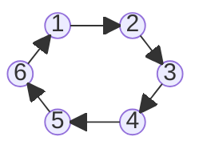
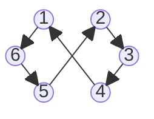
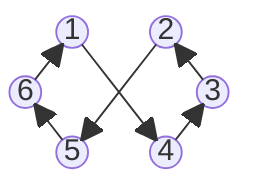
### Initial solution
For generating initial solution we run two experiments per method:
- random: starting with a random solution (random heuristic from lab1)
- greedy: starting with a solution generated by the greedy heuristic from lab1
    - for instance A: Greedy Cycle Weighted 2-regret
    - for instance B: NN (Any Position) Weighted 2-regret

<div style="page-break-after: always;"></div>

## 2. Pseudocode

### Delta calculation
```
// Delta for inter-route move (i, j) where i is in the solution and j is not in the solution
function delta_inter(i,j)
    subtract edge cost for edges connected to i, (i-1, i) and (i, i+1)
    add edge cost for edges connected to j (j-1, j) and (j, j+1)
    subtract cost of node i
    add cost of node j
    return delta


// Delta for intra-route move in node variant (i, j) where i and j are both in the solution
function delta_intra_node(i,j)
    if i and j are adjacent
        subtract edge cost for edges connected to i and j, (i-1, i), and (j, j+1)
        add edge cost for new edges (i-1, j), (i, j+1)
    
    else if i = 0 and j = last index
        subtract edge cost for edges connected to i and j, (i, i+1), and (j-1, j)
        add edge cost for new edges (j-1, i), (i, j+1)

    else
        subtract edge cost for edges connected to i, (i-1, i) and (i, i+1)
        subtract edge cost for edges connected to j, (j-1, j) and (j, j+1)
        add edge cost for new edges, (i-1, j) and (j, i+1)
        add edge cost for new edges, (j-1, i) and (i, j+1)
    
    return delta

// Delta for intra-route move in edge variant (i, j) where i and j are both in the solution
function delta_intra_edge(i,j)
    subtract edge cost for edge i (i-1, i)
    subtract edge cost for edge j (j-1, j)
    add edge cost for new edge (i-1, j)
    add edge cost for new edge (j-1, i)
    return delta
```


### Greedy local search
```
select initial solution

// generate the list of all possible moves
// inter-route moves
for i in solution vector 
    for j in not_in_solution vector
        add move (i, j) to the list of all possible moves

// intra-route moves
for i in solution vector
    for j in i+1 to the length of the solution vector
        add move (i, j) to the list of all possible moves

repeat
    for k in list of all possible moves
        pick random remaining move from the list
        calculate the delta for the move
        if delta < 0 // improves solution
            apply the move
            break
until no improvement found
```

<div style="page-break-after: always;"></div>

### Steepest local search
```
select starting solution
evaluate starting solution
repeat 
    
    // generate and evaluate all inter-route moves
    for i in solution vector 
        for j in not_in_solution vector
            calculate the delta for move (i, j)

    
    // generate and evaluate all intra-route moves
    for i in solution vector
        for j in i+1 to the length of the solution vector
            calculate the delta for move (i, j)

    find best move among all generated moves
    if it improves the solution
        apply the best move
        update the cost
    else
        break
until no improvement found
```

<div style="page-break-after: always;"></div>

## 3. Results
<table>
    <thead>
        <tr>
            <th style="text-align:center">Method</th>
            <th style="text-align:center">Instance A</th>
            <th style="text-align:center">Instance B</th>
        </tr>
    </thead>
    <tbody>
        <tr>
            <th>Random</th>
            <td>261052.4 (236589 - 292354)</td>
            <td>206729.0 (182493 - 234208)</td>
        </tr>
        <tr>
            <th>NN</th>
            <td>87476.6 (84362 - 90075)</td>
            <td>59397.3 (56007 - 63166)</td>
        </tr>
        <tr>
            <th>NN (any position)</th>
            <td>74306.5 (72328 - 77022)</td>
            <td>59476.2 (52915 - 66164)</td>
        </tr>
        <tr>
            <th>Greedy cycle</th>
            <td>73758.4 (72590 - 75345)</td>
            <td>59832.5 (53016 - 63736)</td>
        </tr>
        <tr>
            <th>NN (any position) 2-regret</th>
            <td>121360.0 (110950 - 135771)</td>
            <td>73649.8 (68761 - 79756)</td>
        </tr>
        <tr>
            <th>Greedy cycle 2-regret</th>
            <td>120368.0 (110303 - 128089)</td>
            <td>72368.0 (67078 - 76382)</td>
        </tr>
        <tr>
            <th>NN (any position) weighted 2-regret</th>
            <td>75561.2 (72419 - 78504)</td>
            <td>55698.3 (50485 - 61406)</td>
        </tr>
        <tr>
            <th>Greedy cycle weighted 2-regret</th>
            <td>73349.6 (72011 - 75532)</td>
            <td>57751.4 (52906 - 63326)</td>
        </tr>
        <tr>
            <th>Steepest LS, nodes, random start</th>
            <td>90206.2 (82646 - 99841)</td>
            <td>66119.5 (59051 - 73991)</td>
        </tr>
        <tr>
            <th>Steepest LS, nodes, greedy start</th>
            <td>73017.8 (<b>71955</b> - 74682)</td>
            <td>54292.1 (49978 - 61265)</td>
        </tr>
        <tr>
            <th>Steepest LS, edges, random start</th>
            <td>76116.6 (73687 - 80203)</td>
            <td><b>52428.8</b> (50436 - 55344)</td>
        </tr>
        <tr>
            <th>Steepest LS, edges, greedy start</th>
            <td>72996.7 (<b>71955</b> - 74682)</td>
            <td>53091.5 (<b>49346</b> - 60354)</td>
        </tr>
        <tr>
            <th>Greedy LS, nodes, random start</th>
            <td>87950.4 (81247 - 95195)</td>
            <td>63794.9 (57198 - 71026)</td>
        </tr>
        <tr>
            <th>Greedy LS, nodes, greedy start</th>
            <td>73016.5 (<b>71955</b> - 74682)</td>
            <td>54265.4 (49978 - 61265)</td>
        </tr>
        <tr>
            <th>Greedy LS, edges, random start</th>
            <td>76177.0 (74163 - 79378)</td>
            <td>52844.8 (50612 - 56161)</td>
        </tr>
        <tr>
            <th>Greedy LS, edges, greedy start</th>
            <td><b>72978.5</b> (<b>71955</b> - 74664)</td>
            <td>53223.3 (49661 - 60506)</td>
        </tr>
    </tbody>
</table>

---

### Running time [ms]
<table>
    <thead>
        <tr>
            <th rowspan="2" style="text-align:center">Method</th>
            <th colspan="2" style="text-align:center">Instance</th>
        </tr>
        <tr>
            <th style="text-align:center">A (avg)</th>
            <th style="text-align:center">B (avg)</th>
        </tr>
    </thead>
    <tbody>
        <tr>
            <th>Steepest LS, nodes, random start</th>
            <td>17.79</td>
            <td>17.33</td>
        </tr>
        <tr>
            <th>Steepest LS, nodes, greedy start</th>
            <td>0.64</td>
            <td>1.36</td>
        </tr>
        <tr>
            <th>Steepest LS, edges, random start</th>
            <td>13.90</td>
            <td>13.91</td>
        </tr>
        <tr>
            <th>Steepest LS, edges, greedy start</th>
            <td><b>0.46</b></td>
            <td>1.66</td>
        </tr>
        <tr>
            <th>Greedy LS, nodes, random start</th>
            <td>2.44</td>
            <td>2.36</td>
        </tr>
        <tr>
            <th>Greedy LS, nodes, greedy start</th>
            <td>0.81</td>
            <td><b>1.12</b></td>
        </tr>
        <tr>
            <th>Greedy LS, edges, random start</th>
            <td>1.79</td>
            <td>1.78</td>
        </tr>
        <tr>
            <th>Greedy LS, edges, greedy start</th>
            <td>0.81</td>
            <td>1.22</td>
        </tr>
    </tbody>
</table>

## 5. Best solutions
### Instance A
<table>
    <tr>
        <td align="center">
            Steepest LS, nodes, random start (82646)<br>
            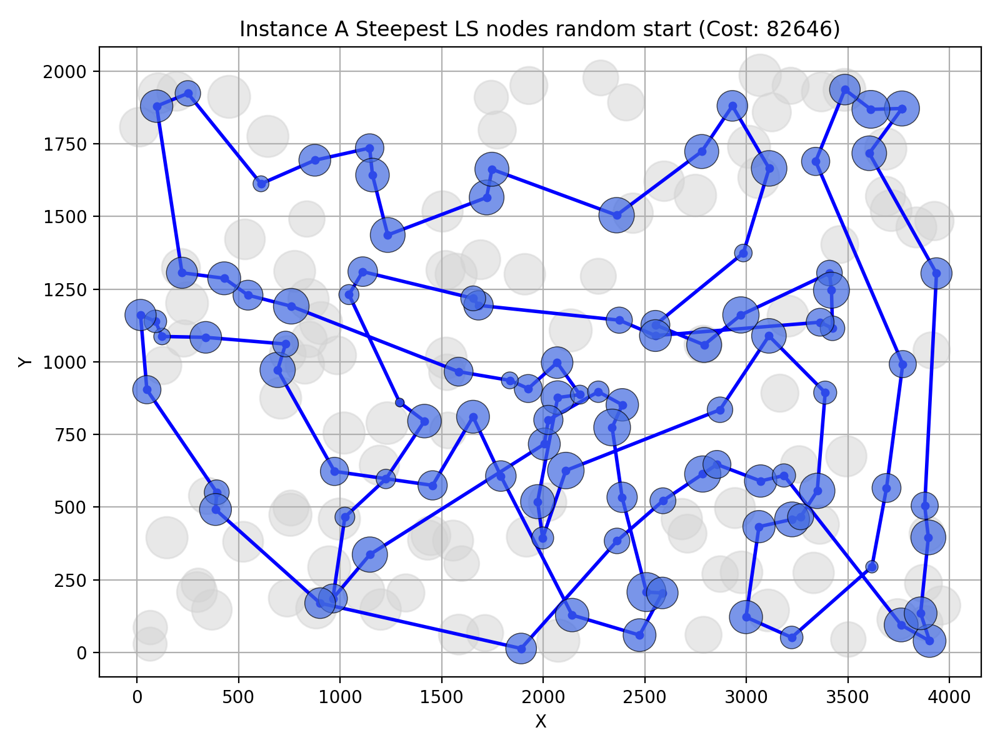
        </td>
        <td align="center">
            Steepest LS, nodes, greedy start (71955)<br>
            
        </td>
    </tr>
    <tr>
        <td align="center">
            Steepest LS, edges, random start (73687)<br>
            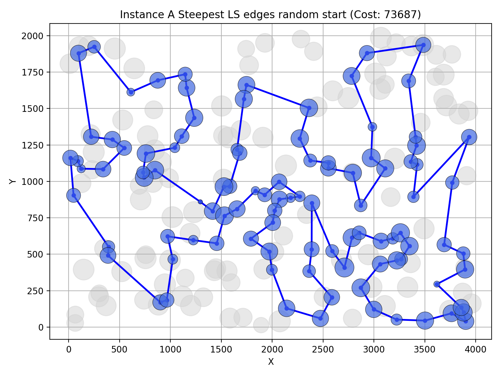
        </td>
        <td align="center">
            Steepest LS, edges, greedy start (71955)<br>
            
        </td>
    </tr>
    <tr>
        <td align="center">
            Greedy LS, nodes, random start (81247)<br>
            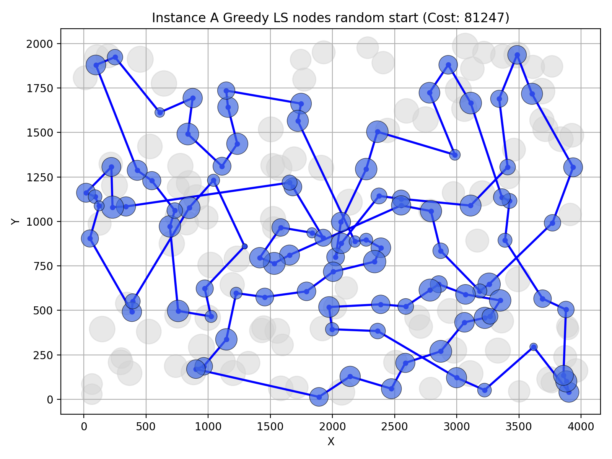
        </td>
        <td align="center">
            Greedy LS, nodes, greedy start (71955)<br>
            
        </td>
    </tr>
    <tr>
        <td align="center">
            Greedy LS, edges, random start (74163)<br>
            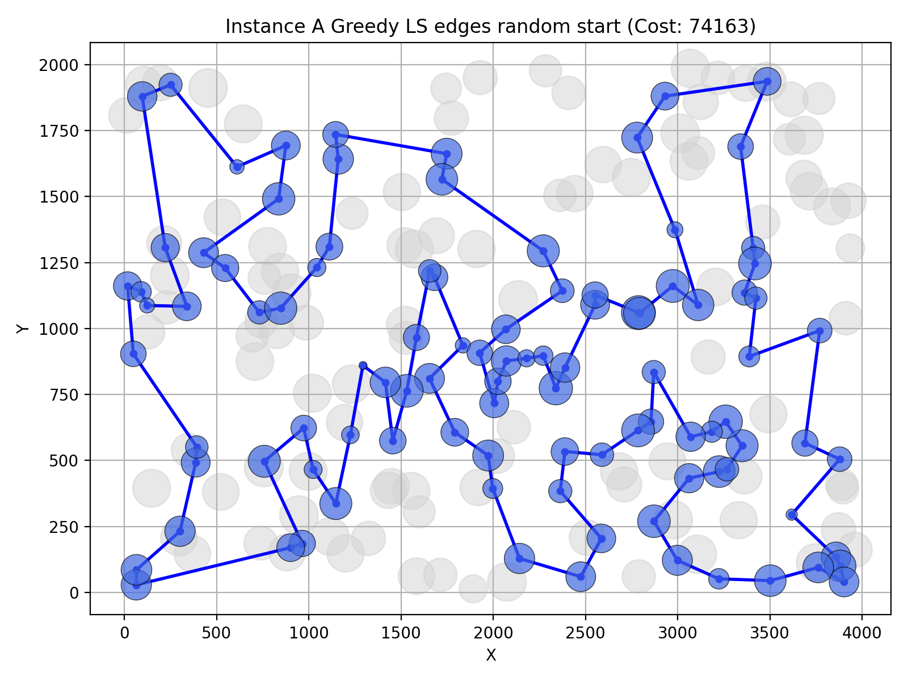
        </td>
        <td align="center">
            Greedy LS, edges, greedy start (71955)<br>
            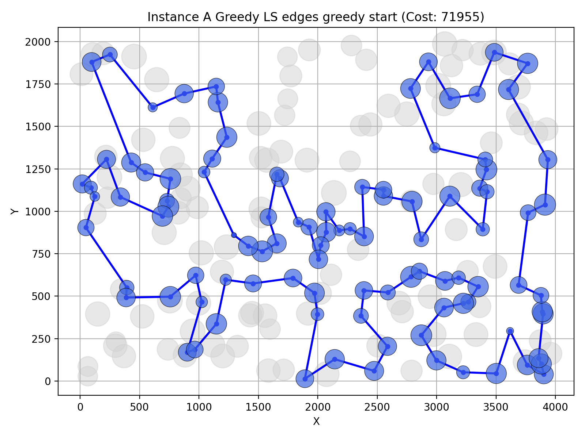
        </td>
    </tr>
</table>

<div style="page-break-after: always;"></div>

### Instance B
<table>
    <tr>
        <td align="center">
            Steepest LS, nodes, random start (59051)<br>
            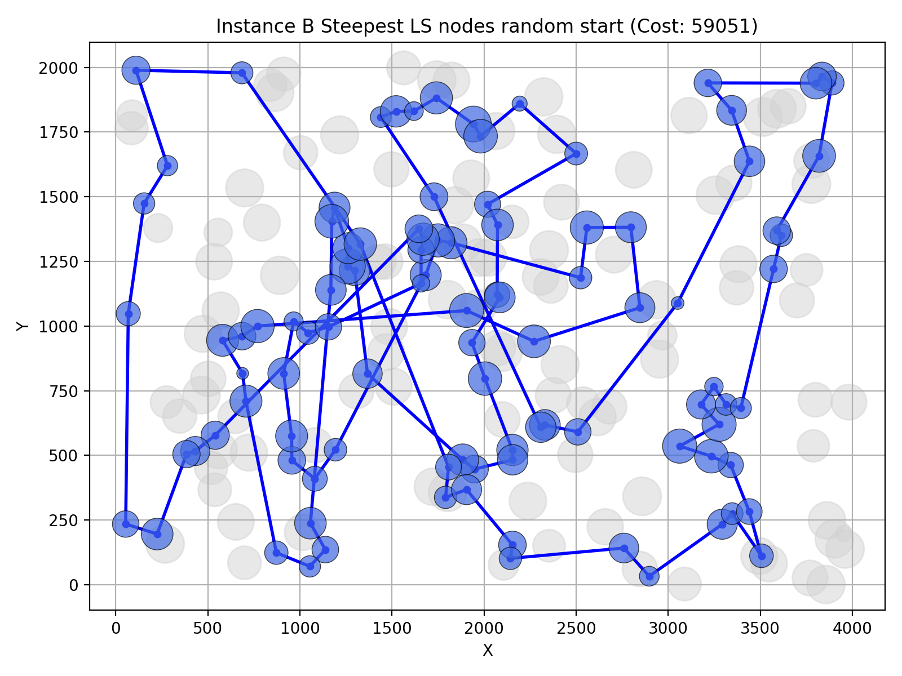
        </td>
        <td align="center">
            Steepest LS, nodes, greedy start (49978)<br>
            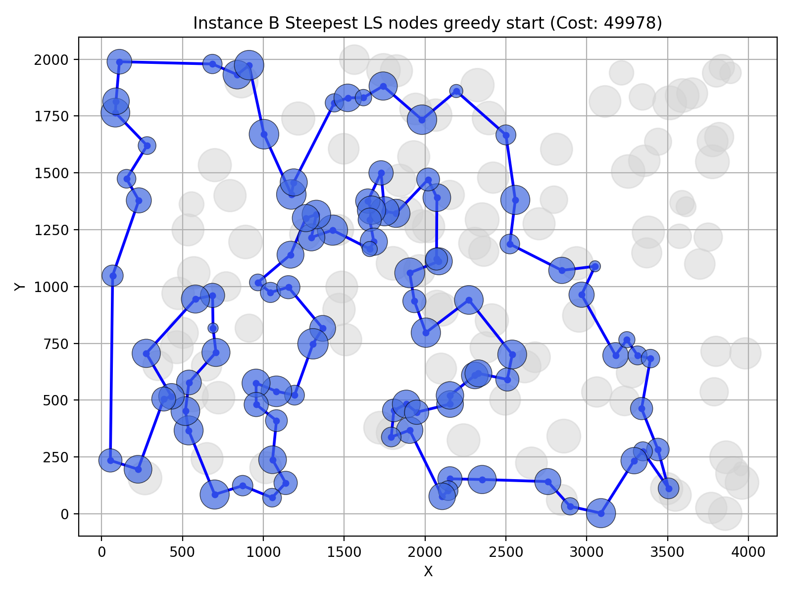
        </td>
    </tr>
    <tr>
        <td align="center">
            Steepest LS, edges, random start (50436)<br>
            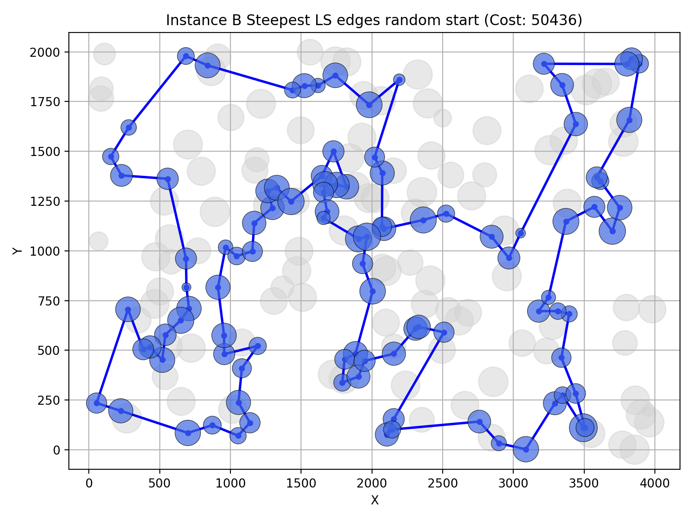
        </td>
        <td align="center">
            Steepest LS, edges, greedy start (49346)<br>
            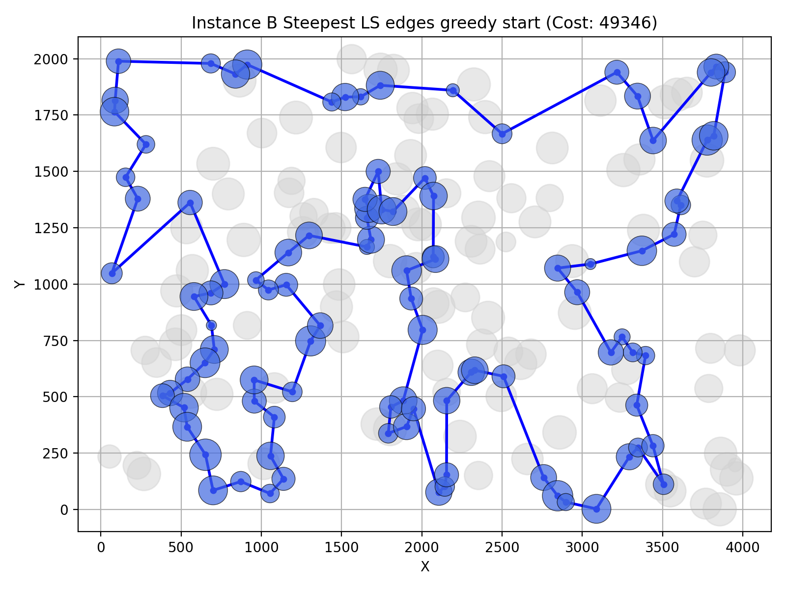
        </td>
    </tr>
    <tr>
        <td align="center">
            Greedy LS, nodes, random start (57198)<br>
            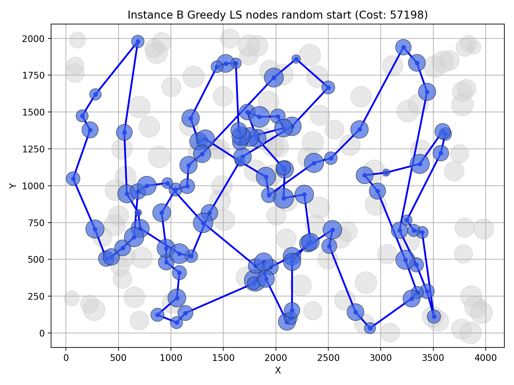
        </td>
        <td align="center">
            Greedy LS, nodes, greedy start (49978)<br>
            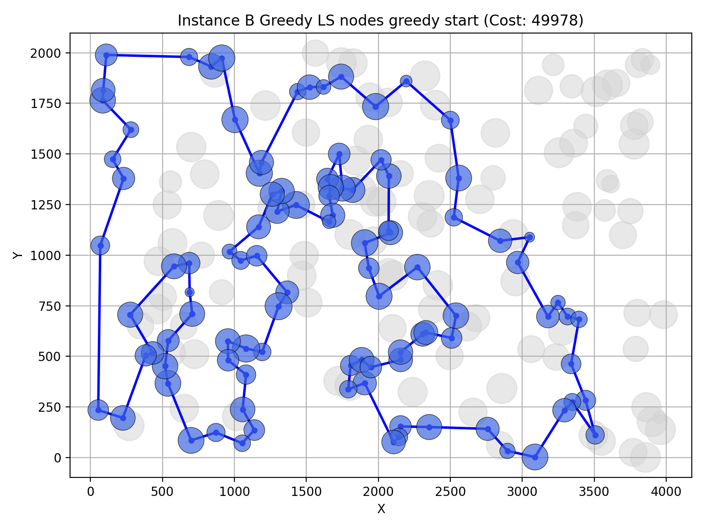
        </td>
    </tr>
    <tr>
        <td align="center">
            Greedy LS, edges, random start (50612)<br>
            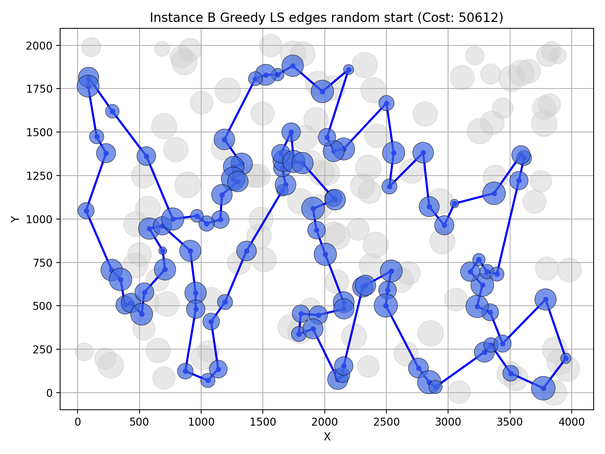
        </td>
        <td align="center">
            Greedy LS, edges, greedy start (49661)<br>
            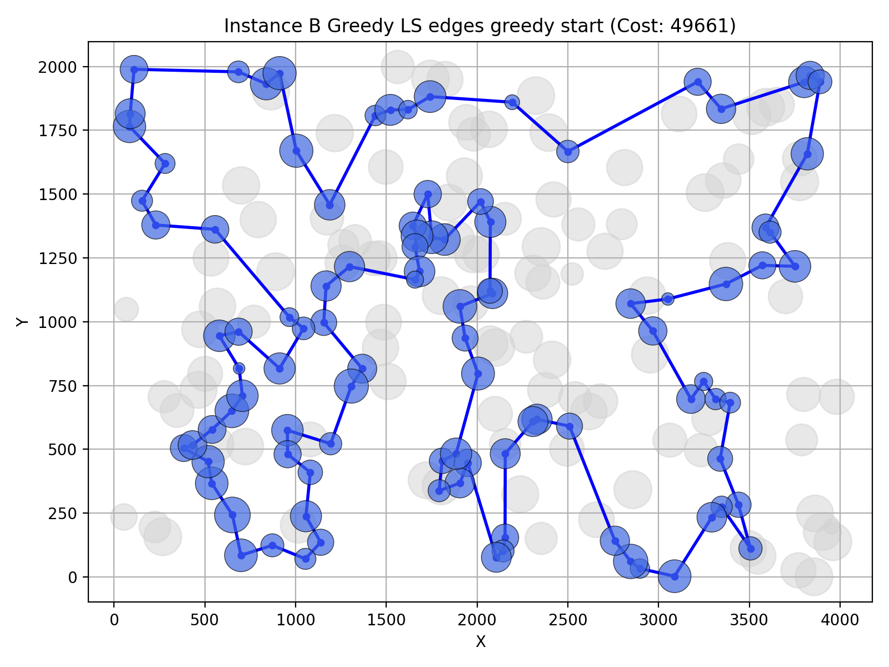
        </td>
    </tr>
</table>

<div style="page-break-after: always;"></div>

## 5. Best solutions - node indices
### Instance A:
Steepest LS, nodes, random start (82646):
```
55, 17, 29, 178, 47, 130, 107, 57, 182, 151, 42, 89, 113, 93, 85, 174, 41, 135, 73, 179, 177, 52, 144, 67, 35, 100, 152, 108, 60, 31, 48, 80, 91, 157, 71, 4, 139, 112, 62, 186, 136, 184, 164, 9, 8, 142, 1, 169, 50, 3, 54, 33, 16, 51, 76, 132, 180, 28, 141, 187, 2, 189, 140, 53, 36, 131, 99, 84, 20, 158, 192, 181, 45, 185, 87, 30, 160, 123, 49, 63, 149, 116, 168, 97, 127, 171, 114, 58, 134, 72, 176, 150, 106, 88, 78, 153, 170, 159, 147, 101
```
Steepest LS, nodes, greedy start (71955):
```
169, 3, 50, 93, 85, 174, 8, 54, 9, 33, 131, 36, 177, 52, 179, 53, 140, 144, 67, 16, 51, 35, 185, 102, 28, 180, 132, 76, 4, 71, 157, 91, 80, 48, 31, 108, 152, 100, 123, 83, 160, 49, 60, 116, 149, 63, 168, 97, 127, 161, 30, 187, 171, 2, 189, 141, 87, 45, 73, 135, 114, 181, 192, 158, 58, 84, 134, 72, 176, 150, 106, 113, 89, 42, 151, 138, 182, 57, 64, 107, 88, 78, 193, 153, 170, 146, 159, 130, 47, 37, 147, 101, 55, 29, 178, 184, 136, 186, 164, 1
```
Steepest LS, edges, random start (73687):
```
147, 93, 50, 3, 169, 1, 178, 29, 136, 186, 164, 142, 85, 174, 8, 54, 9, 33, 143, 62, 112, 139, 51, 16, 35, 156, 28, 180, 90, 83, 123, 100, 132, 76, 4, 71, 157, 91, 80, 48, 31, 60, 108, 152, 49, 63, 149, 116, 168, 97, 127, 171, 2, 187, 30, 141, 87, 102, 185, 67, 144, 52, 36, 177, 179, 53, 140, 45, 73, 135, 181, 192, 158, 58, 84, 131, 134, 65, 72, 176, 150, 106, 43, 113, 89, 42, 151, 138, 182, 57, 64, 88, 78, 193, 153, 107, 170, 159, 130, 47
```
Steepest LS, edges, greedy start (71955):
```
169, 3, 50, 93, 85, 174, 8, 54, 9, 33, 131, 36, 177, 52, 179, 53, 140, 144, 67, 16, 51, 35, 185, 102, 28, 180, 132, 76, 4, 71, 157, 91, 80, 48, 31, 108, 152, 100, 123, 83, 160, 49, 60, 116, 149, 63, 168, 97, 127, 161, 30, 187, 171, 2, 189, 141, 87, 45, 73, 135, 114, 181, 192, 158, 58, 84, 134, 72, 176, 150, 106, 113, 89, 42, 151, 138, 182, 57, 64, 107, 88, 78, 193, 153, 170, 146, 159, 130, 47, 37, 147, 101, 55, 29, 178, 184, 136, 186, 164, 1
```
Greedy LS, nodes, random start (81247):
```
130, 93, 50, 3, 184, 136, 186, 164, 62, 143, 52, 53, 179, 33, 9, 85, 1, 178, 29, 101, 147, 47, 43, 106, 174, 8, 54, 185, 102, 28, 35, 67, 144, 16, 51, 49, 11, 60, 116, 149, 63, 168, 127, 97, 90, 132, 180, 30, 187, 161, 160, 123, 152, 108, 31, 48, 80, 91, 38, 76, 4, 71, 157, 112, 139, 177, 36, 131, 99, 140, 45, 87, 141, 189, 2, 171, 114, 181, 192, 158, 138, 151, 42, 89, 113, 150, 176, 72, 134, 84, 73, 135, 58, 182, 57, 107, 78, 193, 153, 159
```
Greedy LS, nodes, greedy start (71955):
```
169, 3, 50, 93, 85, 174, 8, 54, 9, 33, 131, 36, 177, 52, 179, 53, 140, 144, 67, 16, 51, 35, 185, 102, 28, 180, 132, 76, 4, 71, 157, 91, 80, 48, 31, 108, 152, 100, 123, 83, 160, 49, 60, 116, 149, 63, 168, 97, 127, 161, 30, 187, 171, 2, 189, 141, 87, 45, 73, 135, 114, 181, 192, 158, 58, 84, 134, 72, 176, 150, 106, 113, 89, 42, 151, 138, 182, 57, 64, 107, 88, 78, 193, 153, 170, 146, 159, 130, 47, 37, 147, 101, 55, 29, 178, 184, 136, 186, 164, 1
```
Greedy LS, edges, random start (74163):
```
3, 50, 93, 47, 130, 159, 107, 153, 193, 78, 88, 64, 57, 182, 138, 151, 42, 89, 113, 43, 106, 150, 174, 176, 72, 134, 84, 58, 158, 192, 181, 135, 73, 45, 185, 67, 16, 51, 35, 102, 87, 28, 180, 141, 189, 187, 30, 161, 2, 171, 104, 129, 69, 127, 97, 168, 116, 149, 63, 49, 60, 31, 48, 80, 91, 38, 108, 152, 123, 90, 132, 76, 71, 157, 112, 139, 143, 33, 52, 144, 140, 53, 179, 177, 36, 99, 131, 54, 9, 194, 8, 142, 85, 164, 186, 136, 29, 178, 1, 169
```
Greedy LS, edges, greedy start (71955):
```
169, 3, 50, 93, 85, 174, 8, 54, 9, 33, 131, 36, 177, 52, 179, 53, 140, 144, 67, 16, 51, 35, 185, 102, 28, 180, 132, 76, 4, 71, 157, 91, 80, 48, 31, 108, 152, 100, 123, 83, 160, 49, 60, 116, 149, 63, 168, 97, 127, 161, 30, 187, 171, 2, 189, 141, 87, 45, 73, 135, 114, 181, 192, 158, 58, 84, 134, 72, 176, 150, 106, 113, 89, 42, 151, 138, 182, 57, 64, 107, 88, 78, 193, 153, 170, 146, 159, 130, 47, 37, 147, 101, 55, 29, 178, 184, 136, 186, 164, 1
```

### Instance B:

Steepest LS, nodes, random start (59051):
```
43, 156, 89, 57, 72, 46, 184, 3, 151, 98, 152, 181, 167, 73, 64, 21, 176, 30, 130, 191, 38, 157, 45, 134, 175, 115, 170, 177, 125, 26, 122, 27, 162, 104, 185, 76, 117, 8, 160, 40, 60, 71, 155, 97, 154, 140, 47, 69, 172, 136, 133, 6, 29, 132, 174, 1, 65, 28, 149, 37, 116, 183, 59, 85, 51, 179, 87, 99, 171, 74, 20, 2, 14, 153, 182, 150, 52, 80, 127, 129, 90, 10, 114, 196, 61, 105, 94, 81, 190, 70, 187, 54, 67, 24, 34, 120, 121, 198, 96, 48
```
Steepest LS, nodes, greedy start (49978):
```
65, 145, 28, 149, 13, 146, 37, 116, 147, 42, 50, 191, 130, 121, 198, 96, 48, 156, 89, 57, 185, 76, 162, 54, 192, 80, 127, 129, 90, 153, 14, 2, 20, 74, 17, 171, 99, 88, 179, 87, 82, 51, 85, 59, 73, 167, 181, 152, 34, 24, 67, 66, 27, 98, 151, 122, 3, 184, 46, 72, 117, 8, 120, 133, 136, 172, 160, 69, 189, 21, 183, 30, 38, 154, 140, 47, 64, 33, 40, 141, 155, 71, 60, 157, 45, 134, 175, 62, 36, 197, 6, 115, 170, 125, 177, 178, 29, 132, 174, 1
```
Steepest LS, edges, random start (50436):
```
143, 148, 114, 196, 61, 105, 94, 81, 190, 70, 187, 54, 192, 162, 76, 135, 3, 184, 46, 72, 89, 156, 48, 96, 198, 121, 147, 116, 149, 28, 145, 158, 125, 170, 115, 180, 6, 197, 29, 132, 178, 1, 174, 62, 175, 134, 45, 157, 60, 40, 71, 155, 97, 154, 140, 47, 38, 21, 30, 183, 189, 133, 120, 117, 8, 136, 172, 160, 69, 122, 173, 151, 98, 73, 59, 85, 51, 167, 181, 34, 24, 67, 179, 82, 87, 99, 171, 17, 74, 20, 188, 2, 14, 153, 90, 129, 80, 127, 78, 10
```
Steepest LS, edges, greedy start (49346):
```
89, 48, 96, 198, 121, 42, 147, 116, 37, 146, 13, 149, 28, 145, 65, 158, 26, 125, 177, 170, 115, 180, 6, 29, 132, 197, 36, 91, 62, 175, 134, 45, 157, 60, 71, 155, 40, 33, 64, 47, 140, 154, 38, 21, 69, 160, 172, 136, 133, 120, 8, 117, 72, 46, 184, 3, 122, 151, 98, 73, 59, 85, 51, 167, 82, 87, 179, 181, 34, 24, 67, 99, 39, 171, 17, 74, 20, 2, 14, 153, 90, 129, 127, 80, 192, 162, 54, 78, 10, 114, 196, 139, 61, 105, 94, 81, 187, 70, 190, 57
```
Greedy LS, nodes, random start (57198):
```
130, 30, 183, 69, 122, 151, 135, 76, 104, 190, 70, 187, 80, 153, 14, 2, 90, 129, 127, 10, 114, 196, 78, 54, 162, 192, 182, 20, 74, 171, 99, 67, 66, 152, 167, 101, 85, 45, 134, 175, 157, 60, 71, 155, 97, 140, 47, 38, 21, 156, 89, 57, 86, 160, 64, 40, 141, 115, 170, 177, 158, 116, 149, 28, 145, 65, 178, 132, 29, 6, 180, 125, 26, 154, 33, 59, 73, 51, 82, 87, 179, 181, 34, 24, 27, 111, 3, 184, 117, 120, 92, 72, 46, 8, 172, 136, 133, 96, 198, 121
```
Greedy LS, nodes, greedy start (49978):
```
65, 145, 28, 149, 13, 146, 37, 116, 147, 42, 50, 191, 130, 121, 198, 96, 48, 156, 89, 57, 185, 76, 162, 54, 192, 80, 127, 129, 90, 153, 14, 2, 20, 74, 17, 171, 99, 88, 179, 87, 82, 51, 85, 59, 73, 167, 181, 152, 34, 24, 67, 66, 27, 98, 151, 122, 3, 184, 46, 72, 117, 8, 120, 133, 136, 172, 160, 69, 189, 21, 183, 30, 38, 154, 140, 47, 64, 33, 40, 141, 155, 71, 60, 157, 45, 134, 175, 62, 36, 197, 6, 115, 170, 125, 177, 178, 29, 132, 174, 1
```
Greedy LS, edges, random start (50612):
```
149, 146, 13, 28, 145, 65, 178, 103, 132, 29, 197, 6, 115, 170, 177, 125, 97, 155, 71, 175, 134, 45, 60, 40, 64, 69, 160, 172, 136, 133, 120, 8, 117, 184, 3, 122, 151, 98, 152, 181, 167, 59, 85, 51, 82, 87, 179, 34, 24, 66, 67, 31, 99, 39, 171, 74, 20, 2, 93, 110, 118, 14, 153, 182, 52, 80, 127, 129, 90, 10, 114, 196, 78, 54, 192, 162, 104, 76, 185, 57, 86, 46, 72, 89, 156, 48, 96, 198, 121, 130, 183, 30, 176, 21, 38, 47, 140, 154, 26, 158
```
Greedy LS, edges, greedy start (49661):
```
61, 196, 114, 148, 10, 78, 54, 162, 192, 80, 127, 129, 90, 153, 14, 2, 20, 74, 17, 171, 39, 99, 67, 24, 34, 181, 179, 87, 82, 167, 51, 85, 59, 73, 98, 151, 122, 3, 184, 46, 72, 117, 8, 120, 133, 136, 172, 160, 69, 21, 38, 47, 64, 33, 40, 155, 71, 60, 157, 45, 134, 175, 62, 91, 36, 197, 132, 29, 6, 180, 115, 170, 177, 125, 97, 140, 154, 158, 145, 28, 149, 13, 146, 37, 116, 147, 42, 50, 130, 121, 198, 96, 48, 89, 57, 190, 70, 81, 94, 105
```

## 6. Solution verification
All solutions have been verified with the solution checker and the experiment results match the results from the checker.

<div style="page-break-after: always;"></div>

## 7. Source code
Source code is available on 
[Github](https://github.com/adammierzwicki/evolutionary-computation/tree/main/lab3).

## 8. Conclusions

Applying local search gave a significant improvement over the initial solutions based on random/heuristic methods. Methods starting from a heuristic based method were much better than those starting from a random solution, which is not surprising, since the heuristic already gives a good baseline. This proves that local search quality is highly dependent on the starting solution.

For instance A, the best solution found was 71955, which is only slightly better than the best heuristic (72011). This best solution was actually found by each local search variant starting from a greedy solution (in this case Greedy Cycle Weighted 2-regret). For instance B, the best solution found was 49346, which is about 2% better than the best heuristic (50485). The solution was found by steepest local search with edge intra-neighborhood exchange starting from a greedy solution (in this case NN (Any Position) Weighted 2-regret).

When starting from random solutions, the type of intra-route move makes a large difference. Edge exchange is clearly better than node exchange in all tested configurations. A likely reason is that exchanging edges can remove a crossing in a single move, while exchanging nodes cannot, so the search gets stuck in poorer local optima. With greedy starting solutions the difference is very small, because those solutions contain few crossings.
 
Methods starting from random solutions were significantly slower than those starting from a greedy solution. This is expected because greedy heuristics already provide a solution close to the local optimum, reducing the number of iterations needed for the local search to converge. In the random start scenario, local search has to explore more solutions before it stops improving.

In almost all experiments edge-based neighborhood was faster than node-based neighborhood. Only in two cases in instance B did the node-based neighborhood perform better but probably because these experiments started from a greedy solution and local search performed to few operations to show the advantage of edge-based neighborhood. Overall, the choice of neighborhood structure has a significant impact on the performance of local search.

Greedy LS was significantly faster than Steepest LS in almost all experiments. This is expected because Greedy LS most often evaluate only a few moves before making a decision, whereas Steepest LS evaluates all possible moves to find the best one, which is more time-consuming.