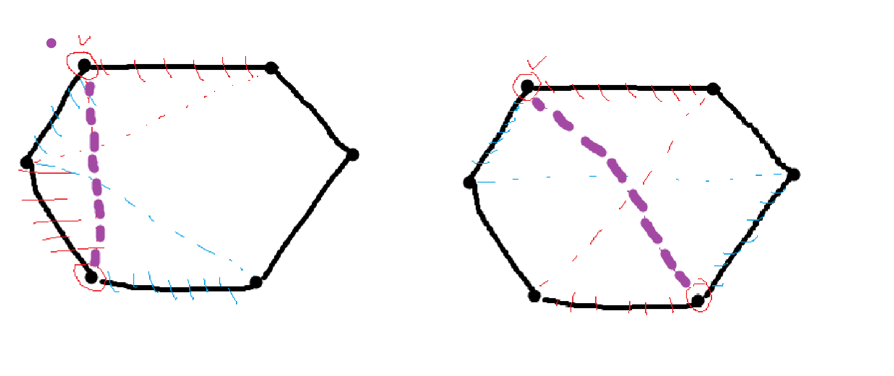
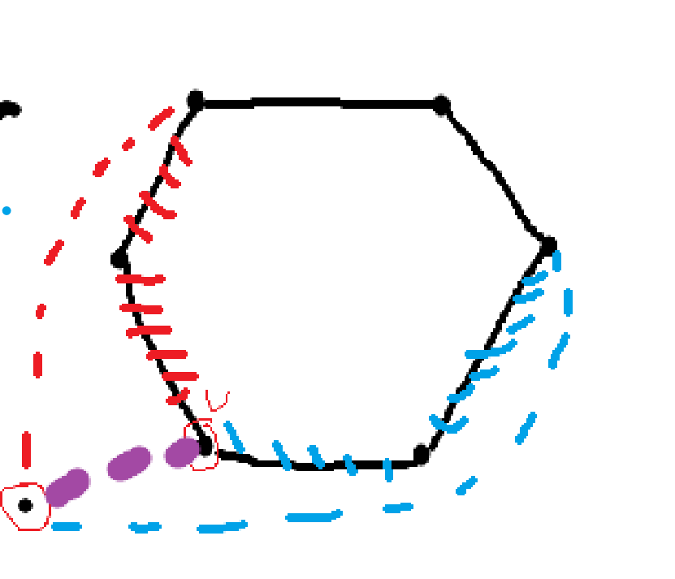
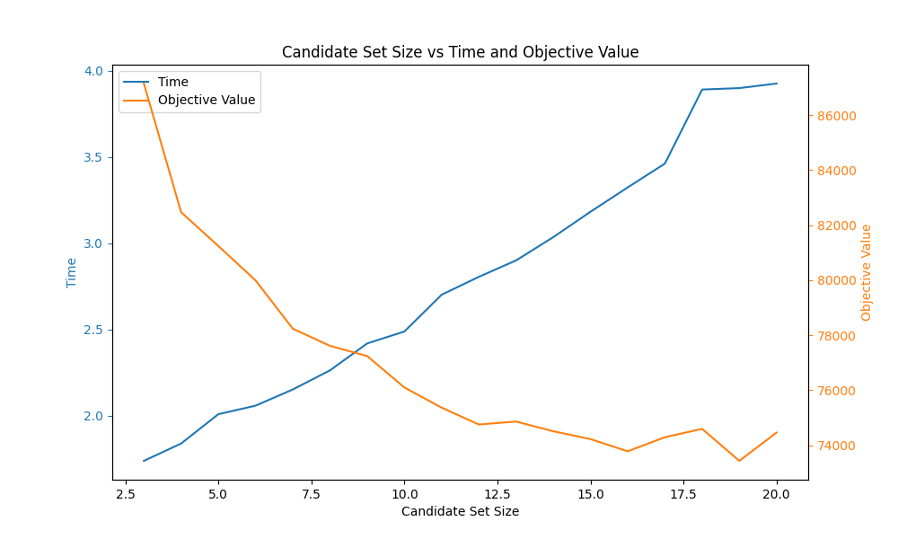
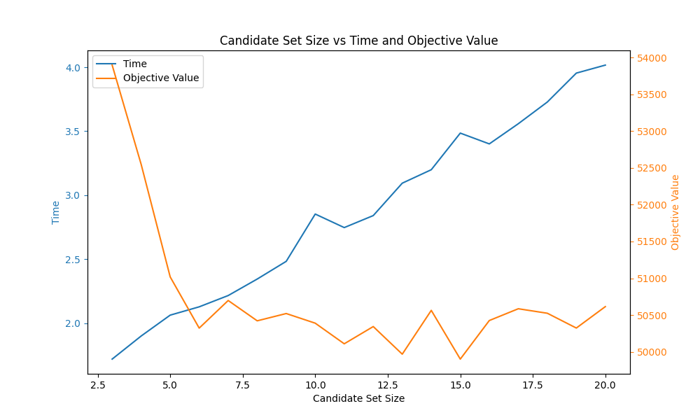
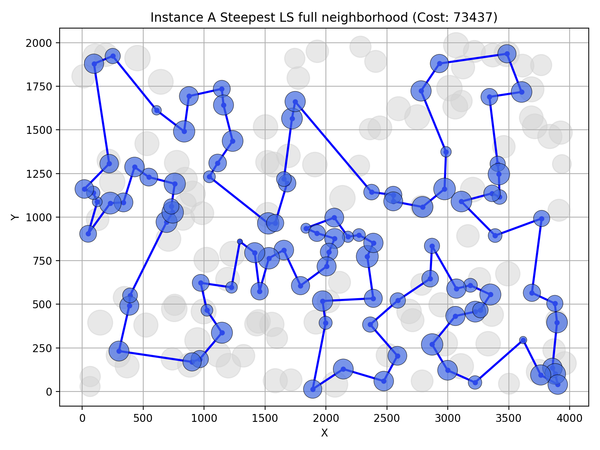
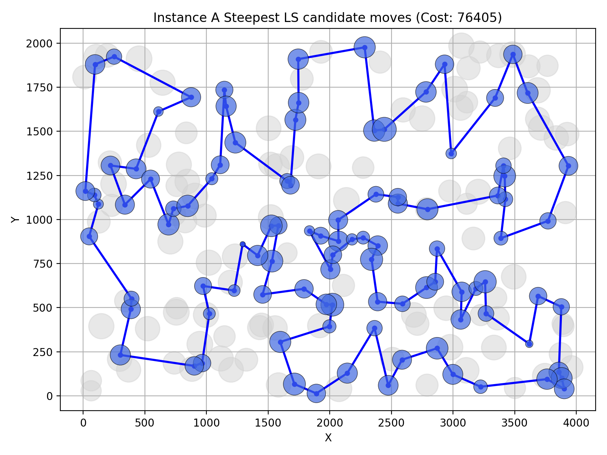
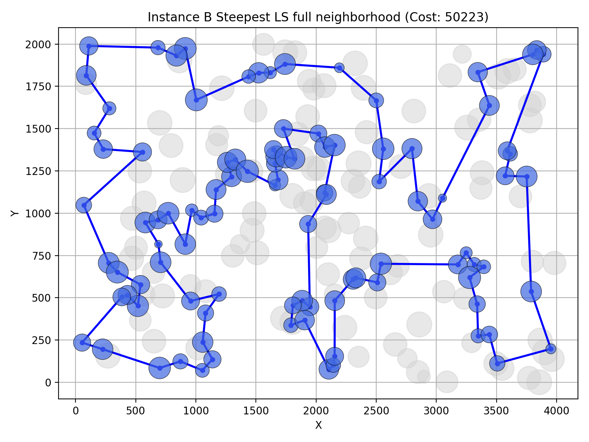
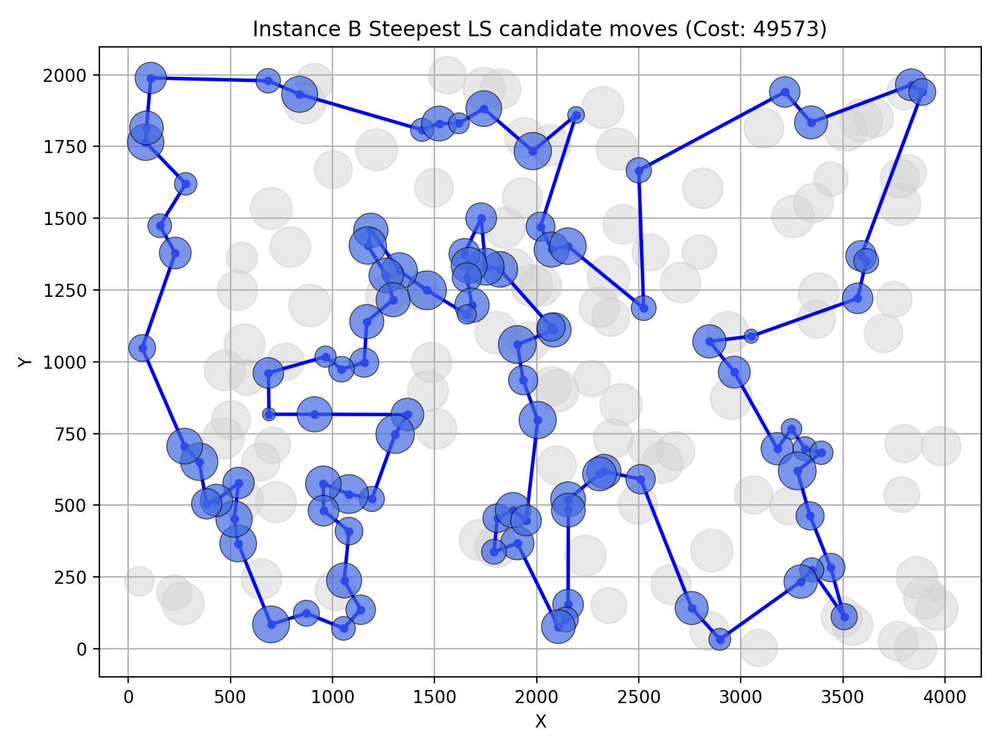

# Candidate moves steepest local search
Adam Mierzwicki 160318, Marcin Perek 160298
## Table of contents
1. Problem description
2. Pseudocode 
3. Results
4. Best solutions
5. Best solutions - node indices
6. Information whether the best solutions have been checked with the solution checker.
7. (Link to) the source code
8. Conclusions

## 1. Problem description
We are given three columns of integers with a row for each node. The first two columns contain x and y coordinates of the node positions in a plane. The third column contains node costs. The goal is to select exactly 50% of the nodes (if the number of nodes is odd we round the number of nodes to be selected up) and form a Hamiltonian cycle (closed path) through this set of nodes such that the sum of the total length of the path plus the total cost of the selected nodes is minimized. The distances between nodes are calculated as Euclidean distances rounded mathematically to integer values. 

### Steepest local search with candidate moves

We compare two variants of steepest LS:
1. **Baseline**: interating over the full neighborhood
2. **Candidate moves**: only moves that introduce at least one candidate edge

<div style="page-break-after: always;"></div>

The neighborhood we consider in the experiment is selected based on best performing one in the previous lab. We consider two types of moves:
1. intra-route edge exchange
2. inter-route edge exchange

<table>
    <tr>
        <td align="center">
            Intra-route edge exchange<br>
            
        </td>
        <td align="center">
            Inter-route edge exchange<br>
            
        </td>
    </tr>
</table>


### Candidate edges are calculated as follows:
For each vertex v, the c nearest vertices (distance + node cost) form a candidate edges. We compared different values of c and plotted the tradeoffs. All comparison is performed on the c=10.

### Initial solution
For generating initial solution we are starting with a random solution (random heuristic from lab1)

<div style="page-break-after: always;"></div>

## 2. Pseudocode

### Candidate moves selection
```
for i in 0 to num_cost
    for j in i+1 to num_points
        dist = dist[i][j]
        add node j with cost dist + cost[j] to candidates[i]
        add node i with cost dist + cost[i] to candidates[j]

for neighborhood in candidates
    sort by cost in increasing order
    trim the list to n neighbors
```

### Steepest local search with candidate edges
```
select starting solution
for i in 0 to solution_len
    pos[solution[i]] = i    // information about being in path and position in path

repeat 
    for i in 0 to solution_len
        for neighbor in candidate moves
            if neighbor not in path
                // inter-route move
                delta1 = dist[node_at_i][neighbor] - dist[node_at_i][node_at_i-1] - cost[node_at_i-1] - dist[node_at_i-1][node_at_i-2] + dist[neighbor][node_at_i-2] + cost[neighbor];
                delta2 = dist[node_at_i][neighbor] - dist[node_at_i][after_node] - cost[after_node] - dist[node_at_i+1][node_at_i+2] + dist[neighbor][node_at_i+2] + cost[neighbor];
                choose lower delta
            else
                // intra-route move
                if node_at_i and neighbor are adjacent
                    skip
                delta1 = -dist_matrix[node_at_i][node_at_i+1] - dist_matrix[neighbor][neighbor+1] + dist_matrix[node_at_i][neighbor] + dist_matrix[node_at_i+1][neighbor+1];
                delta2 = -dist_matrix[node_at_i][node_at_i-1] - dist_matrix[neighbor][neighbor-1] + dist_matrix[node_at_i][neighbor] + dist_matrix[node_at_i-1][neighbor-1];
                choose lower delta
        
    apply the move corresponding to best delta

until no improvement found
```

## 3. Results
<table>
    <thead>
        <tr>
            <th style="text-align:center">Method</th>
            <th style="text-align:center">Instance A</th>
            <th style="text-align:center">Instance B</th>
        </tr>
    </thead>
    <tbody>
        <tr>
            <th>Random</th>
            <td>261052.4 (236589 - 292354)</td>
            <td>206729.0 (182493 - 234208)</td>
        </tr>
        <tr>
            <th>NN</th>
            <td>87476.6 (84362 - 90075)</td>
            <td>59397.3 (56007 - 63166)</td>
        </tr>
        <tr>
            <th>NN (any position)</th>
            <td>74306.5 (72328 - 77022)</td>
            <td>59476.2 (52915 - 66164)</td>
        </tr>
        <tr>
            <th>Greedy cycle</th>
            <td>73758.4 (72590 - 75345)</td>
            <td>59832.5 (53016 - 63736)</td>
        </tr>
        <tr>
            <th>NN (any position) 2-regret</th>
            <td>121360.0 (110950 - 135771)</td>
            <td>73649.8 (68761 - 79756)</td>
        </tr>
        <tr>
            <th>Greedy cycle 2-regret</th>
            <td>120368.0 (110303 - 128089)</td>
            <td>72368.0 (67078 - 76382)</td>
        </tr>
        <tr>
            <th>NN (any position) weighted 2-regret</th>
            <td>75561.2 (72419 - 78504)</td>
            <td>55698.3 (50485 - 61406)</td>
        </tr>
        <tr>
            <th>Greedy cycle weighted 2-regret</th>
            <td>73349.6 (72011 - 75532)</td>
            <td>57751.4 (52906 - 63326)</td>
        </tr>
        <tr>
            <th>Steepest LS, nodes, random start</th>
            <td>90206.2 (82646 - 99841)</td>
            <td>66119.5 (59051 - 73991)</td>
        </tr>
        <tr>
            <th>Steepest LS, nodes, greedy start</th>
            <td>73017.8 (<b>71955</b> - 74682)</td>
            <td>54292.1 (49978 - 61265)</td>
        </tr>
        <tr>
            <th>Steepest LS, edges, random start</th>
            <td>76116.6 (73687 - 80203)</td>
            <td><b>52428.8</b> (50436 - 55344)</td>
        </tr>
        <tr>
            <th>Steepest LS, edges, greedy start</th>
            <td>72996.7 (<b>71955</b> - 74682)</td>
            <td>53091.5 (<b>49346</b> - 60354)</td>
        </tr>
        <tr>
            <th>Greedy LS, nodes, random start</th>
            <td>87950.4 (81247 - 95195)</td>
            <td>63794.9 (57198 - 71026)</td>
        </tr>
        <tr>
            <th>Greedy LS, nodes, greedy start</th>
            <td>73016.5 (<b>71955</b> - 74682)</td>
            <td>54265.4 (49978 - 61265)</td>
        </tr>
        <tr>
            <th>Greedy LS, edges, random start</th>
            <td>76177.0 (74163 - 79378)</td>
            <td>52844.8 (50612 - 56161)</td>
        </tr>
        <tr>
            <th>Greedy LS, edges, greedy start</th>
            <td><b>72978.5</b> (<b>71955</b> - 74664)</td>
            <td>53223.3 (49661 - 60506)</td>
        </tr> 
        <tr>
            <th>Steepest LS with candidate edges</th>
            <td>80135.4 (76405 - 87003)</td>
            <td>52554.9 (49573 - 56602)</td>
        </tr>
    </tbody>
</table>

---

<div style="page-break-after: always;"></div>

### Running time [ms]
<table>
    <thead>
        <tr>
            <th rowspan="2" style="text-align:center">Method</th>
            <th colspan="2" style="text-align:center">Instance</th>
        </tr>
        <tr>
            <th style="text-align:center">A (avg)</th>
            <th style="text-align:center">B (avg)</th>
        </tr>
    </thead>
    <tbody>
        <tr>
            <th>Steepest LS, nodes, random start</th>
            <td>17.79</td>
            <td>17.33</td>
        </tr>
        <tr>
            <th>Steepest LS, nodes, greedy start</th>
            <td>0.64</td>
            <td>1.36</td>
        </tr>
        <tr>
            <th>Steepest LS, edges, random start</th>
            <td>13.90</td>
            <td>13.91</td>
        </tr>
        <tr>
            <th>Steepest LS, edges, greedy start</th>
            <td><b>0.46</b></td>
            <td>1.66</td>
        </tr>
        <tr>
            <th>Greedy LS, nodes, random start</th>
            <td>2.44</td>
            <td>2.36</td>
        </tr>
        <tr>
            <th>Greedy LS, nodes, greedy start</th>
            <td>0.81</td>
            <td><b>1.12</b></td>
        </tr>
        <tr>
            <th>Greedy LS, edges, random start</th>
            <td>1.79</td>
            <td>1.78</td>
        </tr>
        <tr>
            <th>Greedy LS, edges, greedy start</th>
            <td>0.81</td>
            <td>1.22</td>
        </tr>
        <tr>
            <th>Steepest LS with candidate edges</th>
            <td>2.50</td>
            <td>2.61</td>
        </tr>
    </tbody>
</table>

### Direct comparison of steepest LS with and without candidate edges
(compared on the same initial random solution)
<table>
    <thead>
        <tr>
            <th rowspan="3" style="text-align:center">Method</th>
            <th colspan="4" style="text-align:center">Instance</th>
        </tr>
        <tr>
            <th colspan="2" style="text-align:center">A</th>
            <th colspan="2" style="text-align:center">B</th>
        </tr>
        <tr>
            <th style="text-align:center">avg cost</th>
            <th style="text-align:center">avg time</th>
            <th style="text-align:center">avg cost</th>
            <th style="text-align:center">avg time</th>
        </tr>
    </thead>
    <tbody>
        <tr>
            <th>Steepest LS, edges, random start</th>
            <td>76030.3</td>
            <td>9.96</td>
            <td>52542.9</td>
            <td>11.18</td>
        </tr>
        <tr>
            <th>Steepest LS with candidate edges</th>
            <td>80135.4</td>
            <td>2.50</td>
            <td>52554.9</td>
            <td>2.61</td>
        </tr>
    </tbody>
</table>

### Candidate set size comparison
<table>
    <tr>
        <td align="center">
            Instance A<br>
            
        </td>
        <td align="center">
            Instance B<br>
            
        </td>
    </tr>
</table>

<div style="page-break-after: always;"></div>

## 4. Best solutions
### Instance A
<table>
    <tr>
        <td align="center">
            Steepest LS, full neighborhood, random start<br>
            
        </td>
        <td align="center">
            Steepest LS, candidate moves, random start<br>
            
        </td>
    </tr>
</table>

### Instance B
<table>
    <tr>
        <td align="center">
            Steepest LS, full neighborhood, random start<br>
            
        </td>
        <td align="center">
            Steepest LS, candidate moves, random start<br>
            
        </td>
    </tr>
</table>

<div style="page-break-after: always;"></div>

## 5. Best solutions - node indices
### Instance A:
Steepest Local Search with Candidate Moves (76405)
```
31, 48, 91, 80, 108, 60, 49, 152, 160, 123, 90, 132, 76, 157, 71, 4, 51, 16, 139, 112, 115, 39, 62, 15, 186, 136, 164, 178, 29, 101, 147, 47, 93, 50, 169, 1, 3, 8, 54, 9, 33, 52, 179, 144, 67, 140, 53, 177, 36, 131, 99, 84, 134, 72, 176, 174, 150, 151, 106, 43, 89, 107, 130, 159, 153, 193, 78, 88, 57, 182, 138, 158, 192, 58, 181, 114, 25, 98, 135, 61, 73, 45, 87, 102, 35, 156, 28, 180, 141, 30, 187, 2, 171, 69, 127, 97, 168, 63, 149, 116
```

Steepest Local Search w/o Candidate Moves (73437)
```
93, 47, 130, 159, 170, 153, 193, 78, 88, 107, 57, 182, 138, 151, 42, 89, 113, 106, 150, 174, 176, 134, 58, 158, 192, 181, 114, 135, 73, 84, 99, 131, 36, 177, 52, 67, 144, 179, 53, 140, 45, 185, 102, 87, 28, 180, 141, 30, 187, 189, 2, 171, 69, 127, 97, 160, 83, 123, 100, 152, 108, 49, 11, 168, 63, 149, 116, 60, 31, 48, 80, 38, 91, 157, 71, 4, 76, 132, 156, 35, 16, 51, 139, 112, 33, 9, 54, 8, 142, 164, 186, 136, 29, 101, 178, 1, 169, 50, 3, 85
```

### Instance B:
Steepest Local Search with Candidate Moves (49573)
```
192, 80, 127, 129, 90, 52, 153, 14, 2, 20, 74, 171, 99, 67, 24, 34, 152, 181, 179, 87, 82, 51, 85, 59, 73, 167, 98, 151, 122, 3, 184, 117, 8, 120, 133, 136, 172, 160, 69, 168, 183, 130, 191, 30, 21, 38, 47, 140, 154, 125, 170, 97, 64, 33, 40, 141, 155, 71, 60, 157, 45, 134, 175, 62, 36, 197, 6, 29, 132, 103, 178, 65, 145, 28, 149, 13, 146, 37, 116, 147, 121, 198, 96, 48, 156, 89, 72, 46, 86, 76, 57, 190, 70, 94, 105, 196, 114, 10, 54, 162
```

Steepest Local Search w/o Candidate Moves (50223)
```
80, 127, 129, 90, 52, 153, 20, 14, 2, 110, 118, 148, 10, 114, 196, 105, 94, 81, 70, 187, 54, 192, 162, 104, 76, 185, 57, 89, 48, 96, 198, 121, 50, 42, 147, 116, 37, 146, 149, 28, 145, 158, 65, 178, 103, 6, 197, 29, 132, 1, 174, 62, 175, 134, 45, 157, 60, 40, 71, 115, 170, 177, 125, 26, 97, 154, 140, 47, 38, 21, 30, 183, 189, 69, 160, 172, 136, 133, 8, 117, 120, 72, 46, 86, 184, 3, 151, 167, 73, 59, 85, 51, 82, 87, 179, 181, 34, 24, 67, 66
```

<div style="page-break-after: always;"></div>

## 6. Solution verification
All solutions have been verified with the solution checker and the experiment results match the results from the checker.


## 7. Source code
Source code is available on 
[Github](https://github.com/adammierzwicki/evolutionary-computation/tree/main/lab4).

## 8. Conclusions
In general LS with candidate edges performed a bit worse but still comparable to standard LS in terms of objective function but the runtime improved significantly (up to 5x faster). That is expected as we greatly reduced the size of searched neighborhood which should lead to a speed up at the cost of slightly worse objective function.

We performed candidate set size comparison and plotted how the size of the candidate set affects the running time and objective function value. We can see that the running time is increasing (almost linearly) with the size of the candidate set. The objective function value is decreasing quite rapidly reaching the optimal tradeoff between running time and objective function at c_size = 9 for Instance A and c_size = 6 for Instance B. In instance B we can observe that the drop in objective function value is sharper and the value at the best tradeoff is around the best solution found all the time.


