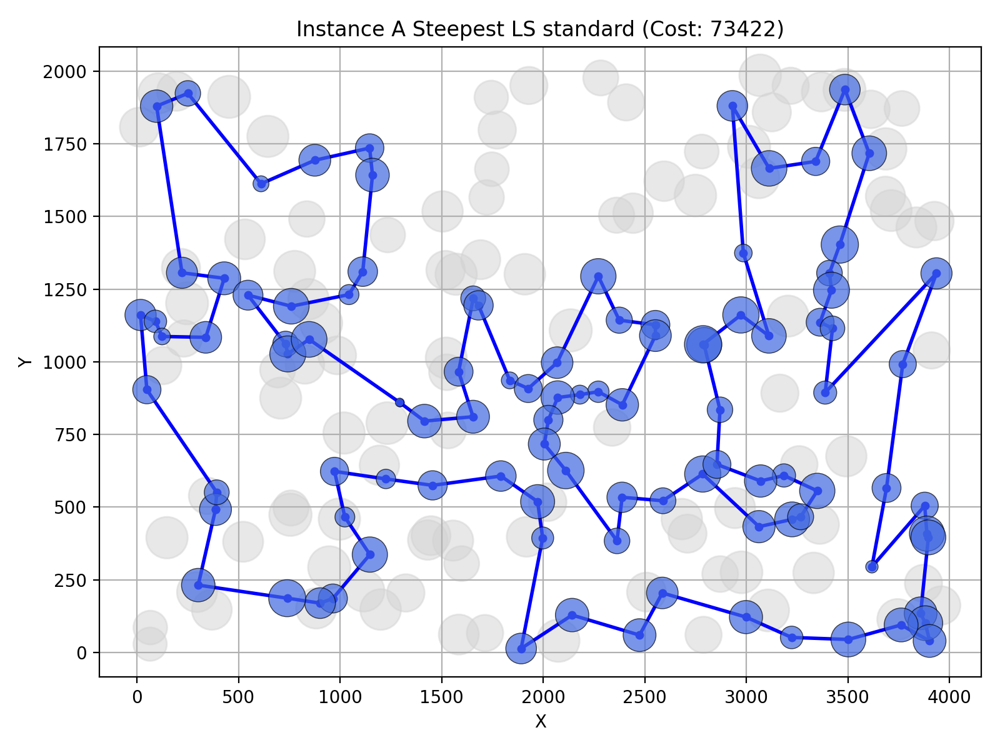
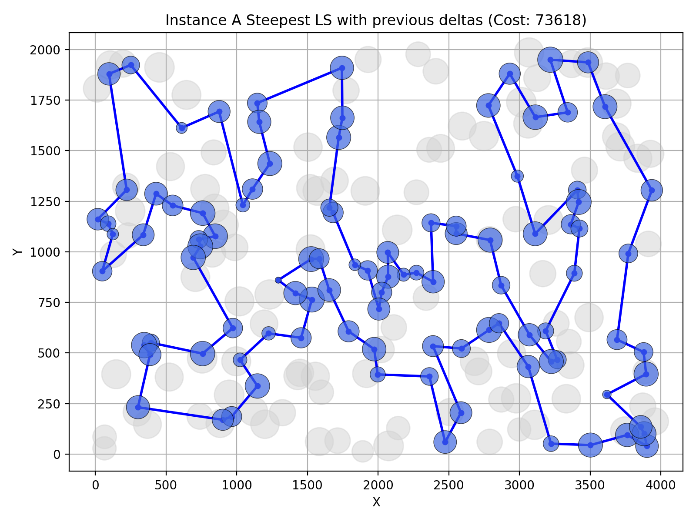
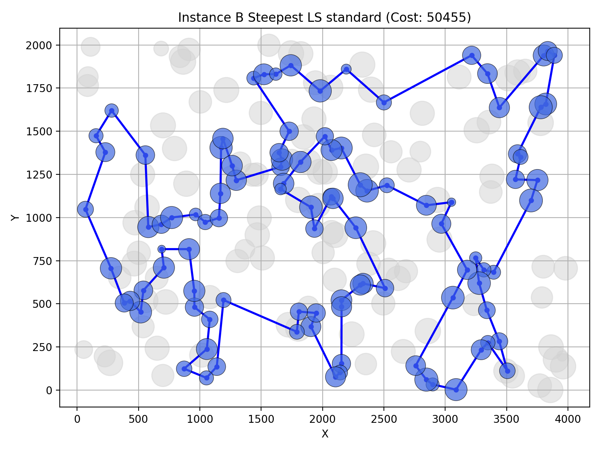
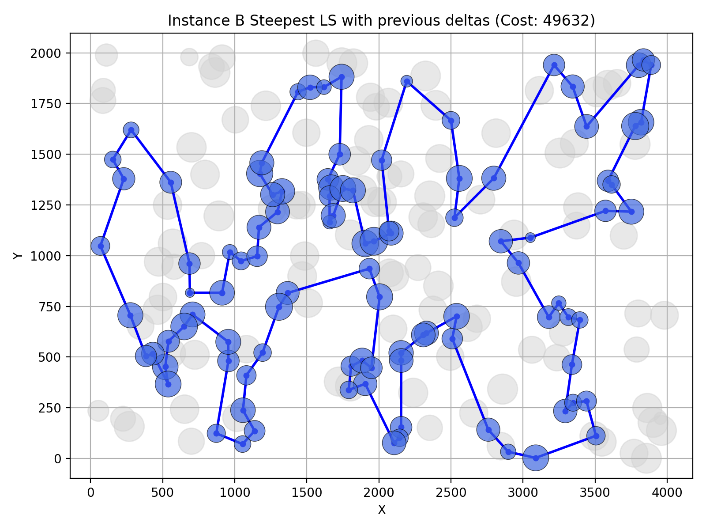

# Local search with previous deltas
Adam Mierzwicki 160318, Marcin Perek 160298
## Table of contents
1. Problem description
2. Pseudocode 
3. Results
4. Best solutions
5. Best solutions - node indices
6. Information whether the best solutions have been checked with the solution checker.
7. (Link to) the source code
8. Conclusions

## 1. Problem description
We are given three columns of integers with a row for each node. The first two columns contain x and y coordinates of the node positions in a plane. The third column contains node costs. The goal is to select exactly 50% of the nodes (if the number of nodes is odd we round the number of nodes to be selected up) and form a Hamiltonian cycle (closed path) through this set of nodes such that the sum of the total length of the path plus the total cost of the selected nodes is minimized. The distances between nodes are calculated as Euclidean distances rounded mathematically to integer values. 

### Steepest local search with previous deltas

We compare two variants of Steepest LS:
1. **Baseline**: evaluate whole neighborhood at each iteration
2. **With delta memory**: keep a sorted list of past evaluated moves ordered by delta, search through the list and evaluate new moves only if there was no applicable move found

### Initial solution
For generating initial solution we are starting with a random solution (random heuristic from lab1)

<div style="page-break-after: always;"></div>

## 2. Pseudocode

### Is applicable
```
if move is intra-route
    if any node belonging to the edges is not in cycle
        return -1
    if nodes are not adjacent in the cycle
        return -1
    
    edge1_direction = (idx_a + 1) % n == idx_b # if the edge still points in the same direction
    edge2_direction = (idx_c + 1) % n == idx_d
    if edge1_direction != edge2_direction
        return 0
    
    return 1

else
    if a is not in cycle and b is in cycle
        if neighbors of a are unchanged
            return 1

return -1
```

### Evaluate moves
```
generate inter-route neighbors
for v_in, v_out in neighbors
    calculate delta
    if delta < 0
        add to lm

generate intra-route neighbors
for e1, e2 in neighbors
    calculate delta
    if delta < 0
        add to lm
    
    calculate delta assuming inverted e2
    if inverted_delta < 0
        add to lm
```
<div style="page-break-after: always;"></div>

### Steepest local search with previous deltas
```
select starting solution

// idx in the solution or -1 if not present
for i in 0 to solution_len
    pos[solution[i]] = i

// idx in helper array or -1 if not present
for i in 0 to not_in_solution_len
    pos_out[not_in_solution[i]] = i

initialize lm   // empty always sorted list
evaluate moves for initial solution

repeat 
    for move in lm
        ret = is_applicable
        if ret == -1
            remove move from lm
        else if ret == 0
            continue
        else
            best_move = move
            remove move from lm
    if best_move found
        if best_move is intra-route move
            if edge are in the same direction as saved
                reverse segment from edge1_end to edge2_start
            else
                reverse segment from edge1_start to edge2_end
        else
            swap vertices in cycle
            update pos, pos_out and not_in_solution
        same_solution = false
    else
        if same_solution
            break
        evaluate moves for current solution
        same_solution = true
until no applicable moves found in lm after evaluate
```
<div style="page-break-after: always;"></div>

## 3. Results

### Direct comparison of steepest LS with and without previous deltas
(compared on the same initial random solution)
<table>
    <thead>
        <tr>
            <th rowspan="3" style="text-align:center">Method</th>
            <th colspan="4" style="text-align:center">Instance</th>
        </tr>
        <tr>
            <th colspan="2" style="text-align:center">A</th>
            <th colspan="2" style="text-align:center">B</th>
        </tr>
        <tr>
            <th style="text-align:center">avg cost</th>
            <th style="text-align:center">avg time (ms)</th>
            <th style="text-align:center">avg cost</th>
            <th style="text-align:center">avg time (ms)</th>
        </tr>
    </thead>
    <tbody>
        <tr>
            <th>Steepest LS, edges, random start</th>
            <td>76122.7</td>
            <td>7.97</td>
            <td>52555.7</td>
            <td>7.77</td>
        </tr>
        <tr>
            <th>Steepest LS with previous deltas</th>
            <td>76082.7</td>
            <td><b>2.30</b></td>
            <td>52570.2</td>
            <td><b>2.47</b></td>
        </tr>
    </tbody>
</table>

### Number of full neighborhood evaluations per run
<table>
    <thead>
        <tr>
            <th rowspan="2" style="text-align:center">Method</th>
            <th colspan="2" style="text-align:center">Instance</th>
        </tr>
        <tr>
            <th style="text-align:center">A (avg)</th>
            <th style="text-align:center">B (avg)</th>
        </tr>
    </thead>
    <tbody>
        <tr>
            <th>Steepest LS, edges, random start</th>
            <td>133.65</td>
            <td>135.37</td>
        </tr>
        <tr>
            <th>Steepest LS with previous deltas</th>
            <td><b>8.80</b></td>
            <td><b>9.10</b></td>
        </tr>
    </tbody>
</table>

### Comparison of all methods
<table>
    <thead>
        <tr>
            <th style="text-align:center">Method</th>
            <th style="text-align:center">Instance A</th>
            <th style="text-align:center">Instance B</th>
        </tr>
    </thead>
    <tbody>
        <tr>
            <th>Random</th>
            <td>261052.4 (236589 - 292354)</td>
            <td>206729.0 (182493 - 234208)</td>
        </tr>
        <tr>
            <th>NN</th>
            <td>87476.6 (84362 - 90075)</td>
            <td>59397.3 (56007 - 63166)</td>
        </tr>
        <tr>
            <th>NN (any position)</th>
            <td>74306.5 (72328 - 77022)</td>
            <td>59476.2 (52915 - 66164)</td>
        </tr>
        <tr>
            <th>Greedy cycle</th>
            <td>73758.4 (72590 - 75345)</td>
            <td>59832.5 (53016 - 63736)</td>
        </tr>
        <tr>
            <th>NN (any position) 2-regret</th>
            <td>121360.0 (110950 - 135771)</td>
            <td>73649.8 (68761 - 79756)</td>
        </tr>
        <tr>
            <th>Greedy cycle 2-regret</th>
            <td>120368.0 (110303 - 128089)</td>
            <td>72368.0 (67078 - 76382)</td>
        </tr>
        <tr>
            <th>NN (any position) weighted 2-regret</th>
            <td>75561.2 (72419 - 78504)</td>
            <td>55698.3 (50485 - 61406)</td>
        </tr>
        <tr>
            <th>Greedy cycle weighted 2-regret</th>
            <td>73349.6 (72011 - 75532)</td>
            <td>57751.4 (52906 - 63326)</td>
        </tr>
        <tr>
            <th>Steepest LS, nodes, random start</th>
            <td>90206.2 (82646 - 99841)</td>
            <td>66119.5 (59051 - 73991)</td>
        </tr>
        <tr>
            <th>Steepest LS, nodes, greedy start</th>
            <td>73017.8 (<b>71955</b> - 74682)</td>
            <td>54292.1 (49978 - 61265)</td>
        </tr>
        <tr>
            <th>Steepest LS, edges, random start</th>
            <td>76116.6 (73687 - 80203)</td>
            <td><b>52428.8</b> (50436 - 55344)</td>
        </tr>
        <tr>
            <th>Steepest LS, edges, greedy start</th>
            <td>72996.7 (<b>71955</b> - 74682)</td>
            <td>53091.5 (<b>49346</b> - 60354)</td>
        </tr>
        <tr>
            <th>Greedy LS, nodes, random start</th>
            <td>87950.4 (81247 - 95195)</td>
            <td>63794.9 (57198 - 71026)</td>
        </tr>
        <tr>
            <th>Greedy LS, nodes, greedy start</th>
            <td>73016.5 (<b>71955</b> - 74682)</td>
            <td>54265.4 (49978 - 61265)</td>
        </tr>
        <tr>
            <th>Greedy LS, edges, random start</th>
            <td>76177.0 (74163 - 79378)</td>
            <td>52844.8 (50612 - 56161)</td>
        </tr>
        <tr>
            <th>Greedy LS, edges, greedy start</th>
            <td><b>72978.5</b> (<b>71955</b> - 74664)</td>
            <td>53223.3 (49661 - 60506)</td>
        </tr> 
        <tr>
            <th>Steepest LS with candidate edges</th>
            <td>80135.4 (76405 - 87003)</td>
            <td>52554.9 (49573 - 56602)</td>
        </tr>
        <tr>
            <th>Steepest LS with previous deltas</th>
            <td>76082.7 (73618 - 79726)</td>
            <td>52570.2 (49632 - 55701)</td>
        </tr>
    </tbody>
</table>

---

### Running time [ms] of all methods
<table>
    <thead>
        <tr>
            <th rowspan="2" style="text-align:center">Method</th>
            <th colspan="2" style="text-align:center">Instance</th>
        </tr>
        <tr>
            <th style="text-align:center">A (avg)</th>
            <th style="text-align:center">B (avg)</th>
        </tr>
    </thead>
    <tbody>
        <tr>
            <th>Steepest LS, nodes, random start</th>
            <td>17.79</td>
            <td>17.33</td>
        </tr>
        <tr>
            <th>Steepest LS, nodes, greedy start</th>
            <td>0.64</td>
            <td>1.36</td>
        </tr>
        <tr>
            <th>Steepest LS, edges, random start</th>
            <td>13.90</td>
            <td>13.91</td>
        </tr>
        <tr>
            <th>Steepest LS, edges, greedy start</th>
            <td><b>0.46</b></td>
            <td>1.66</td>
        </tr>
        <tr>
            <th>Greedy LS, nodes, random start</th>
            <td>2.44</td>
            <td>2.36</td>
        </tr>
        <tr>
            <th>Greedy LS, nodes, greedy start</th>
            <td>0.81</td>
            <td><b>1.12</b></td>
        </tr>
        <tr>
            <th>Greedy LS, edges, random start</th>
            <td>1.79</td>
            <td>1.78</td>
        </tr>
        <tr>
            <th>Greedy LS, edges, greedy start</th>
            <td>0.81</td>
            <td>1.22</td>
        </tr>
        <tr>
            <th>Steepest LS with candidate edges</th>
            <td>2.50</td>
            <td>2.61</td>
        </tr>
        <tr>
            <th>Steepest LS with previous deltas</th>
            <td>2.30</td>
            <td>2.47</td>
        </tr>
    </tbody>
</table>


<div style="page-break-after: always;"></div>

## 4. Best solutions
### Instance A
<table>
    <tr>
        <td align="center">
            Steepest LS, edges, random start<br>
            
        </td>
        <td align="center">
            Steepest LS with previous deltas, random start<br>
            
        </td>
    </tr>
</table>

### Instance B
<table>
    <tr>
        <td align="center">
            Steepest LS, edges, random start<br>
            
        </td>
        <td align="center">
            Steepest LS with previous deltas, random start<br>
            
        </td>
    </tr>
</table>

<div style="page-break-after: always;"></div>

## 5. Best solutions - node indices
### Instance A:
Steepest Local Search with Previous Deltas (73618)
```
2, 189, 187, 141, 87, 102, 28, 180, 156, 35, 185, 45, 73, 135, 58, 192, 158, 84, 134, 72, 176, 151, 57, 64, 88, 78, 193, 153, 107, 170, 159, 130, 47, 147, 101, 29, 163, 178, 184, 136, 186, 164, 85, 1, 169, 3, 50, 93, 106, 89, 42, 150, 174, 8, 54, 9, 33, 131, 36, 177, 52, 179, 53, 140, 144, 67, 16, 51, 139, 112, 115, 157, 71, 4, 76, 132, 91, 80, 48, 31, 60, 116, 149, 63, 168, 49, 108, 152, 100, 90, 123, 83, 160, 30, 161, 97, 95, 127, 69, 171
```

Steepest Local Search (73422)
```
127, 97, 168, 116, 149, 63, 49, 108, 60, 31, 48, 80, 91, 157, 71, 76, 132, 100, 152, 123, 83, 90, 180, 28, 185, 35, 51, 16, 67, 144, 52, 143, 33, 9, 54, 131, 36, 177, 179, 53, 140, 41, 58, 84, 134, 72, 151, 42, 89, 113, 106, 150, 176, 174, 8, 194, 142, 85, 164, 136, 184, 178, 29, 101, 59, 1, 169, 3, 50, 93, 147, 47, 130, 107, 159, 146, 170, 153, 193, 78, 88, 64, 57, 182, 158, 192, 181, 114, 135, 73, 45, 87, 141, 30, 187, 189, 2, 171, 92, 69
```

### Instance B:
Steepest Local Search with Previous Deltas (49632)
```
97, 154, 140, 47, 38, 21, 183, 30, 191, 130, 121, 198, 96, 48, 120, 133, 136, 172, 69, 160, 8, 117, 122, 173, 3, 184, 72, 89, 57, 185, 76, 104, 190, 70, 187, 81, 94, 105, 61, 139, 196, 114, 148, 10, 54, 162, 192, 80, 127, 129, 90, 153, 74, 20, 14, 2, 17, 171, 99, 67, 66, 24, 34, 152, 181, 179, 87, 82, 51, 85, 59, 73, 167, 98, 151, 64, 33, 40, 60, 157, 45, 134, 175, 71, 155, 115, 180, 6, 197, 36, 29, 132, 178, 65, 145, 28, 149, 158, 125, 170
```

Steepest Local Search (50455)
```
21, 172, 136, 133, 120, 121, 198, 96, 48, 156, 89, 57, 190, 70, 187, 81, 94, 105, 61, 139, 196, 114, 10, 148, 143, 90, 129, 127, 52, 153, 14, 2, 20, 74, 17, 171, 39, 99, 150, 80, 192, 54, 162, 76, 135, 75, 86, 46, 72, 117, 160, 69, 122, 151, 184, 3, 27, 67, 24, 34, 152, 181, 179, 87, 82, 51, 167, 59, 85, 40, 45, 134, 175, 157, 60, 71, 155, 97, 170, 115, 6, 197, 29, 132, 178, 65, 145, 28, 149, 158, 177, 125, 26, 154, 140, 47, 38, 191, 130, 30
```

<div style="page-break-after: always;"></div>

## 6. Solution verification
All solutions have been verified with the solution checker and the experiment results match the results from the checker.


## 7. Source code
Source code is available on 
[Github](https://github.com/adammierzwicki/evolutionary-computation/tree/main/lab5).

## 8. Conclusions
Local search with previous deltas is significantly faster than the baseline steepest local search, being more than 3 times faster on average.

Time improvement is cause by great reduction in number of evaluations, around 2 orders of magnitude. The real time difference is smaller because of need to maintain a sorted list of evaluated moves.

The quality of the solutions is comparable in both instances, they both have almost the same average cost but the best solutions were found by the local search with previous deltas (which in the case of such small differences could be due to random chance).