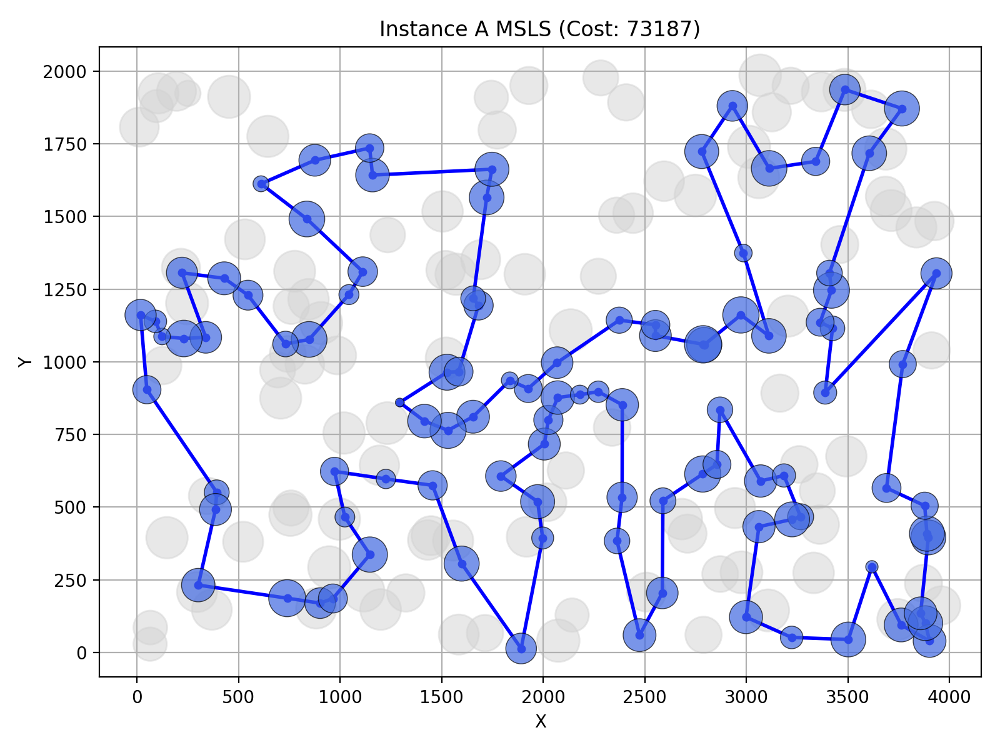
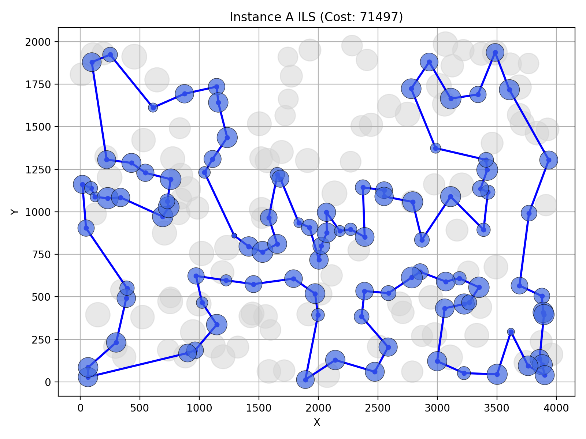
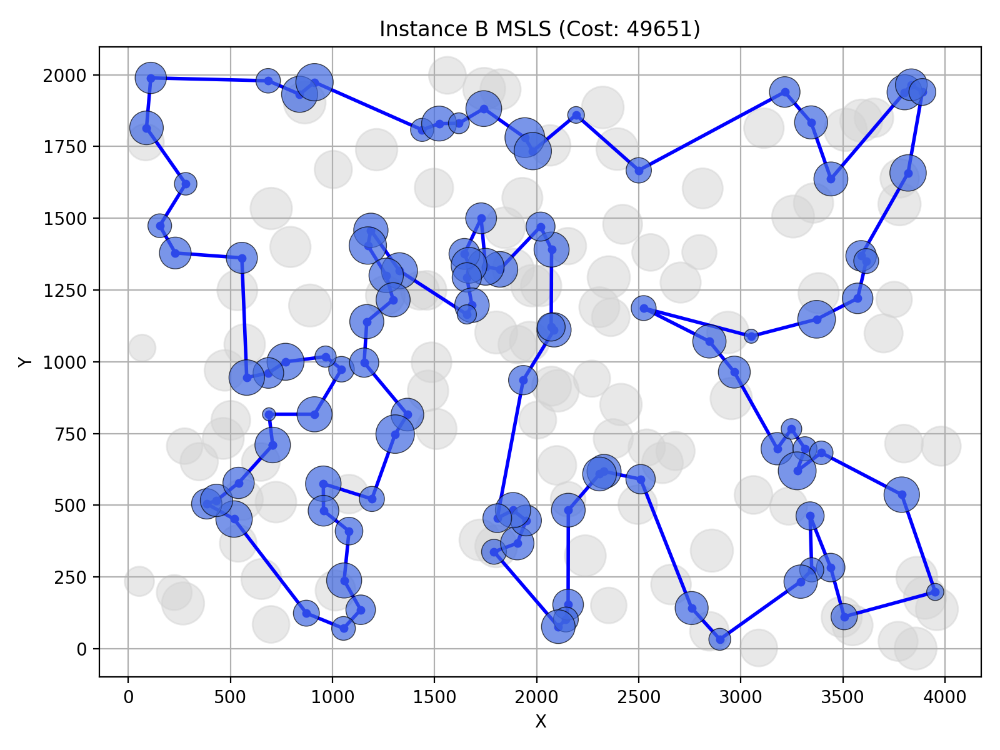
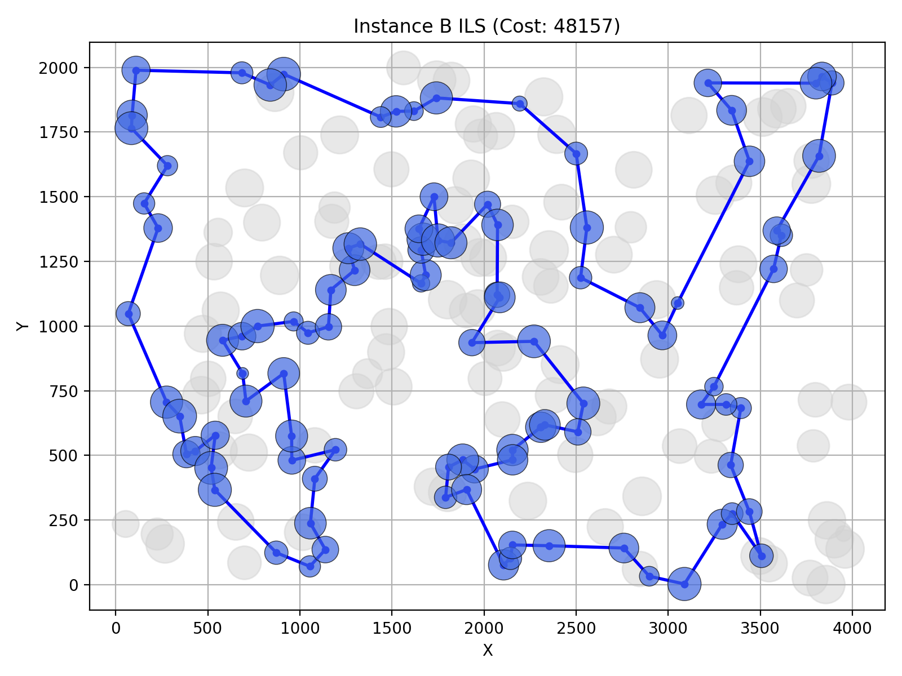

# MSLS and ILS
Adam Mierzwicki 160318, Marcin Perek 160298
## Table of contents
1. Problem description
2. Pseudocode 
3. Results
4. Best solutions
5. Best solutions - node indices
6. Information whether the best solutions have been checked with the solution checker.
7. (Link to) the source code
8. Conclusions

## 1. Problem description
We are given three columns of integers with a row for each node. The first two columns contain x and y coordinates of the node positions in a plane. The third column contains node costs. The goal is to select exactly 50% of the nodes (if the number of nodes is odd we round the number of nodes to be selected up) and form a Hamiltonian cycle (closed path) through this set of nodes such that the sum of the total length of the path plus the total cost of the selected nodes is minimized. The distances between nodes are calculated as Euclidean distances rounded mathematically to integer values. 

### Local search version
In both methods we use the **steepest local search with the list of improving moves** from the previous assignment. The neighborhood consists of inter-route moves (exchange of a selected node with a non-selected one) and intra-route moves (edge exchange).

### Multiple start local search (MSLS)
MSLS repeats the local search 400 times, each time starting from a new random solution. The result of a single MSLS run is the best of the 400 local optima.

### Iterated local search (ILS)
ILS starts from one random solution, improves it with the local search and then repeats three steps until the time limit is reached:
1. Perturb the current best solution
2. Find a local optimum of the perturbed solution using the local search
3. Accept the result only if it is better than the best solution so far

The stopping condition is the average running time of one MSLS run. We also report the number of local search calls performed in one ILS run.

<div style="page-break-after: always;"></div>

### Perturbation
At each iteration one of two perturbations is chosen with equal probability. Both are designed so that a single move of the local search cannot immediately undo them.

**Double bridge (intra-route)** Three distinct random cut points `p1 < p2 < p3` split the cycle into four segments A|B|C|D. The new cycle is A|C|B|D. Two segments swap places and none is reversed, so this cannot be undone by a single edge exchange (which only reverses a segment).

Example: 

cycle `0 1 2 3 4 5 6 7 8 9` with cuts `p1=2, p2=5, p3=8`:

A=`0 1`, B=`2 3 4`, C=`5 6 7`, D=`8 9` => `0 1 | 5 6 7 | 2 3 4 | 8 9`

**Node exchange (inter-route)** 
1. Remove `k = 5` random nodes from the cycle. 
2. Repeat `k` times: for every node outside the cycle (excluding the just removed ones) compute the cost of inserting it at its cheapest position (insertion delta + node cost), take the `pool = 10` cheapest candidates, pick one at random and insert it at its cheapest position.

The number of selected nodes stays the same, but the set of selected nodes changes. Choosing randomly from the best candidates instead of the best one, keeps the perturbation random while still giving a reasonable solution.

<div style="page-break-after: always;"></div>

## 2. Pseudocode

### Multiple start local search
```
best_solution = none
best_cost = infinity

repeat 400 times
    init_solution = random_solution()
    solution = steepest_ls_with_prev_deltas(init_solution)
    if cost(solution) < best_cost
        update best_cost and best_solution

return best_solution
```

### Iterated local search
```
init_solution = random_solution()
best_solution = steepest_ls_with_prev_deltas(init_solution)
best_cost = cost(best_solution)
ls_calls = 1

while running_time < average_time_of_one_msls_run
    perturbed_solution = perturb(best_solution)
    solution = steepest_ls_with_prev_deltas(perturbed_solution)
    ls_calls += 1
    if cost(solution) < best_cost
        update best_cost and best_solution

return best_solution
```

### Perturbation
```
perturb(solution)
    with probability 0.5
        return double_bridge(solution)
    else
        return exchange_nodes(solution)
```

<div style="page-break-after: always;"></div>

### Double bridge
```
n = len(solution)
if n < 8
    return solution

choose 3 distinct random cut points p1, p2, p3 in [1, n-1]
order them so that p1 < p2 < p3

A = solution[0 : p1]
B = solution[p1 : p2]
C = solution[p2 : p3]
D = solution[p3 : n]

return A + C + B + D
```

### Node exchange
```
// 1. remove k random nodes from the solution
repeat k times
    remove a random node from solution
    mark it as removed

// 2. insert new nodes into the solution
repeat k times
    options = []
    for u in nodes not in solution and not removed
        best_pos = select the position that minimizes dist[a][u] + dist[u][b] - dist[a][b]
        options.append(insertion_delta + cost[u], u, best_pos)
    
    keep the `pool = 10` options with the smallest value
    randomly select one node of the remaining options
    insert u into solution after its best_pos

return solution
```

<div style="page-break-after: always;"></div>

## 3. Results

### Comparison with the best earlier methods
<table>
    <thead>
        <tr>
            <th style="text-align:center">Method</th>
            <th style="text-align:center">Instance A</th>
            <th style="text-align:center">Instance B</th>
        </tr>
    </thead>
    <tbody>
        <tr>
            <th>Greedy cycle weighted 2-regret (best heuristic Instance A)</th>
            <td>73349.6 (72011 - 75532)</td>
            <td>57751.4 (52906 - 63326)</td>
        </tr>
        <tr>
            <th>NN (any position) weighted 2-regret (best heuristic Instance B)</th>
            <td>75561.2 (72419 - 78504)</td>
            <td>55698.3 (50485 - 61406)</td>
        </tr>
        <tr>
            <th>Steepest LS, edges, greedy start</th>
            <td>72996.7 (71955 - 74682)</td>
            <td>53091.5 (49346 - 60354)</td>
        </tr>
        <tr>
            <th>Steepest LS with previous deltas, random start</th>
            <td>76082.7 (73618 - 79726)</td>
            <td>52570.2 (49632 - 55701)</td>
        </tr>
        <tr>
            <th>MSLS</th>
            <td>73569.1 (73187 - 74095)</td>
            <td>50207.2 (49651 - 50547)</td>
        </tr>
        <tr>
            <th>ILS</th>
            <td><b>71683.4 (71497 - 72033)</b></td>
            <td><b>48455.1 (48157 - 49195)</b></td>
        </tr>
    </tbody>
</table>

### Running time comparison [ms]
<table>
    <thead>
        <tr>
            <th rowspan="2" style="text-align:center">Method</th>
            <th colspan="3" style="text-align:center">Instance A</th>
            <th colspan="3" style="text-align:center">Instance B</th>
        </tr>
        <tr>
            <th style="text-align:center">total time</th>
            <th style="text-align:center">LS calls (avg)</th>
            <th style="text-align:center">time per LS call</th>
            <th style="text-align:center">total time</th>
            <th style="text-align:center">LS calls (avg)</th>
            <th style="text-align:center">time per LS call</th>
        </tr>
    </thead>
    <tbody>
        <tr>
            <th>Steepest LS, edges, greedy start</th>
            <td>7.97</td>
            <td>1</td>
            <td>7.97</td>
            <td>7.77</td>
            <td>1</td>
            <td>7.77</td>
        </tr>
        <tr>
            <th>Steepest LS with previous deltas, random start</th>
            <td>2.30</td>
            <td>1</td>
            <td>2.30</td>
            <td>2.47</td>
            <td>1</td>
            <td>2.47</td>
        </tr>
        <tr>
            <th>MSLS</th>
            <td>831.52</td>
            <td>400</td>
            <td>2.08</td>
            <td>812.60</td>
            <td>400</td>
            <td>2.03</td>
        </tr>
        <tr>
            <th>ILS</th>
            <td>840.19</td>
            <td>2291.3</td>
            <td><b>0.37</b></td>
            <td>840.19</td>
            <td>2290.75</td>
            <td><b>0.37</b></td>
        </tr>
    </tbody>
</table>

### Number of local search calls in ILS (per run)
<table>
    <thead>
        <tr>
            <th rowspan="2" style="text-align:center">Method</th>
            <th colspan="3" style="text-align:center">Instance A</th>
            <th colspan="3" style="text-align:center">Instance B</th>
        </tr>
        <tr>
            <th style="text-align:center">min</th>
            <th style="text-align:center">avg</th>
            <th style="text-align:center">max</th>
            <th style="text-align:center">min</th>
            <th style="text-align:center">avg</th>
            <th style="text-align:center">max</th>
        </tr>
    </thead>
    <tbody>
        <tr>
            <th>ILS, number of LS calls</th>
            <td>2176</td>
            <td>2291.3</td>
            <td>2344</td>
            <td>2201</td>
            <td>2290.75</td>
            <td>2415</td>
        </tr>
        <tr>
            <th>MSLS, number of LS calls</th>
            <td>400</td>
            <td>400</td>
            <td>400</td>
            <td>400</td>
            <td>400</td>
            <td>400</td>
        </tr>
    </tbody>
</table>

<div style="page-break-after: always;"></div>

### Number of full neighborhood evaluations per single LS call
<table>
    <thead>
        <tr>
            <th rowspan="2" style="text-align:center">Method</th>
            <th colspan="3" style="text-align:center">Instance A</th>
            <th colspan="3" style="text-align:center">Instance B</th>
        </tr>
        <tr>
            <th style="text-align:center">min</th>
            <th style="text-align:center">avg</th>
            <th style="text-align:center">max</th>
            <th style="text-align:center">min</th>
            <th style="text-align:center">avg</th>
            <th style="text-align:center">max</th>
        </tr>
    </thead>
    <tbody>
        <tr>
            <th>MSLS</th>
            <td>6</td>
            <td>8.88</td>
            <td>19</td>
            <td>6</td>
            <td>9.04</td>
            <td>16</td>
        </tr>
        <tr>
            <th>ILS</th>
            <td><b>1</b></td>
            <td><b>4.40</b></td>
            <td><b>15</b></td>
            <td><b>1</b></td>
            <td><b>4.33</b></td>
            <td><b>13</b></td>
        </tr>
    </tbody>
</table>


### Comparison of all methods
<table>
    <thead>
        <tr>
            <th style="text-align:center">Method</th>
            <th style="text-align:center">Instance A</th>
            <th style="text-align:center">Instance B</th>
        </tr>
    </thead>
    <tbody>
        <tr>
            <th>Random</th>
            <td>261052.4 (236589 - 292354)</td>
            <td>206729.0 (182493 - 234208)</td>
        </tr>
        <tr>
            <th>NN</th>
            <td>87476.6 (84362 - 90075)</td>
            <td>59397.3 (56007 - 63166)</td>
        </tr>
        <tr>
            <th>NN (any position)</th>
            <td>74306.5 (72328 - 77022)</td>
            <td>59476.2 (52915 - 66164)</td>
        </tr>
        <tr>
            <th>Greedy cycle</th>
            <td>73758.4 (72590 - 75345)</td>
            <td>59832.5 (53016 - 63736)</td>
        </tr>
        <tr>
            <th>NN (any position) 2-regret</th>
            <td>121360.0 (110950 - 135771)</td>
            <td>73649.8 (68761 - 79756)</td>
        </tr>
        <tr>
            <th>Greedy cycle 2-regret</th>
            <td>120368.0 (110303 - 128089)</td>
            <td>72368.0 (67078 - 76382)</td>
        </tr>
        <tr>
            <th>NN (any position) weighted 2-regret</th>
            <td>75561.2 (72419 - 78504)</td>
            <td>55698.3 (50485 - 61406)</td>
        </tr>
        <tr>
            <th>Greedy cycle weighted 2-regret</th>
            <td>73349.6 (72011 - 75532)</td>
            <td>57751.4 (52906 - 63326)</td>
        </tr>
        <tr>
            <th>Steepest LS, nodes, random start</th>
            <td>90206.2 (82646 - 99841)</td>
            <td>66119.5 (59051 - 73991)</td>
        </tr>
        <tr>
            <th>Steepest LS, nodes, greedy start</th>
            <td>73017.8 (71955 - 74682)</td>
            <td>54292.1 (49978 - 61265)</td>
        </tr>
        <tr>
            <th>Steepest LS, edges, random start</th>
            <td>76116.6 (73687 - 80203)</td>
            <td>52428.8 (50436 - 55344)</td>
        </tr>
        <tr>
            <th>Steepest LS, edges, greedy start</th>
            <td>72996.7 (71955 - 74682)</td>
            <td>53091.5 (49346 - 60354)</td>
        </tr>
        <tr>
            <th>Greedy LS, nodes, random start</th>
            <td>87950.4 (81247 - 95195)</td>
            <td>63794.9 (57198 - 71026)</td>
        </tr>
        <tr>
            <th>Greedy LS, nodes, greedy start</th>
            <td>73016.5 (71955 - 74682)</td>
            <td>54265.4 (49978 - 61265)</td>
        </tr>
        <tr>
            <th>Greedy LS, edges, random start</th>
            <td>76177.0 (74163 - 79378)</td>
            <td>52844.8 (50612 - 56161)</td>
        </tr>
        <tr>
            <th>Greedy LS, edges, greedy start</th>
            <td>72978.5 (71955 - 74664)</td>
            <td>53223.3 (49661 - 60506)</td>
        </tr> 
        <tr>
            <th>Steepest LS with candidate edges</th>
            <td>80135.4 (76405 - 87003)</td>
            <td>52554.9 (49573 - 56602)</td>
        </tr>
        <tr>
            <th>Steepest LS with previous deltas</th>
            <td>76082.7 (73618 - 79726)</td>
            <td>52570.2 (49632 - 55701)</td>
        </tr>
        <tr>
            <th>MSLS</th>
            <td>73569.1 (73187 - 74095)</td>
            <td>50207.2 (49651 - 50547)</td>
        </tr>
        <tr>
            <th>ILS</th>
            <td><b>71683.4</b> (<b>71497 - 72033</b>)</td>
            <td><b>48455.1</b> (<b>48157 - 49195</b>)</td>
        </tr>
    </tbody>
</table>

<div style="page-break-after: always;"></div>

### Running time [ms] of all methods
<table>
    <thead>
        <tr>
            <th rowspan="2" style="text-align:center">Method</th>
            <th colspan="2" style="text-align:center">Instance</th>
        </tr>
        <tr>
            <th style="text-align:center">A (avg)</th>
            <th style="text-align:center">B (avg)</th>
        </tr>
    </thead>
    <tbody>
        <tr>
            <th>Steepest LS, nodes, random start</th>
            <td>17.79</td>
            <td>17.33</td>
        </tr>
        <tr>
            <th>Steepest LS, nodes, greedy start</th>
            <td>0.64</td>
            <td>1.36</td>
        </tr>
        <tr>
            <th>Steepest LS, edges, random start</th>
            <td>13.90</td>
            <td>13.91</td>
        </tr>
        <tr>
            <th>Steepest LS, edges, greedy start</th>
            <td><b>0.46</b></td>
            <td>1.66</td>
        </tr>
        <tr>
            <th>Greedy LS, nodes, random start</th>
            <td>2.44</td>
            <td>2.36</td>
        </tr>
        <tr>
            <th>Greedy LS, nodes, greedy start</th>
            <td>0.81</td>
            <td><b>1.12</b></td>
        </tr>
        <tr>
            <th>Greedy LS, edges, random start</th>
            <td>1.79</td>
            <td>1.78</td>
        </tr>
        <tr>
            <th>Greedy LS, edges, greedy start</th>
            <td>0.81</td>
            <td>1.22</td>
        </tr>
        <tr>
            <th>Steepest LS with candidate edges</th>
            <td>2.50</td>
            <td>2.61</td>
        </tr>
        <tr>
            <th>Steepest LS with previous deltas</th>
            <td>2.30</td>
            <td>2.47</td>
        </tr>
        <tr>
            <th>MSLS</th>
            <td>831.52</td>
            <td>812.60</td>
        </tr>
        <tr>
            <th>ILS</th>
            <td>840.19</td>
            <td>840.19</td>
        </tr>
    </tbody>
</table>


<div style="page-break-after: always;"></div>

## 4. Best solutions
### Instance A
<table>
    <tr>
        <td align="center">
            MSLS (cost 73187)<br>
            
        </td>
        <td align="center">
            ILS (cost 71497)<br>
            
        </td>
    </tr>
</table>

### Instance B
<table>
    <tr>
        <td align="center">
            MSLS (cost 49651)<br>
            
        </td>
        <td align="center">
            ILS (cost 48157)<br>
            
        </td>
    </tr>
</table>

<div style="page-break-after: always;"></div>

## 5. Best solutions - node indices
### Instance A
MSLS (cost 73187)

`[182, 57, 64, 107, 88, 78, 193, 153, 170, 146, 159, 130, 47, 147, 93, 50, 3, 169, 1, 101, 55, 29, 178, 184, 136, 186, 164, 85, 142, 8, 194, 54, 9, 33, 52, 144, 67, 185, 102, 28, 180, 156, 35, 16, 51, 139, 112, 71, 157, 91, 80, 38, 76, 132, 90, 123, 152, 108, 60, 49, 11, 63, 149, 116, 168, 97, 127, 69, 92, 171, 2, 189, 187, 30, 141, 87, 98, 114, 135, 73, 45, 140, 53, 179, 177, 36, 131, 84, 58, 192, 158, 134, 72, 176, 174, 150, 106, 89, 42, 151]`

ILS (cost 71497)

`[28, 102, 185, 35, 51, 16, 67, 144, 140, 53, 179, 52, 177, 36, 131, 33, 9, 54, 8, 174, 85, 93, 50, 3, 169, 1, 164, 186, 136, 184, 178, 29, 101, 147, 47, 130, 159, 146, 170, 153, 193, 78, 88, 107, 64, 57, 182, 151, 42, 89, 113, 106, 150, 176, 72, 134, 84, 58, 158, 192, 181, 114, 135, 73, 45, 87, 141, 30, 187, 189, 2, 171, 104, 129, 69, 127, 97, 168, 116, 149, 63, 11, 49, 160, 83, 123, 100, 152, 108, 60, 31, 48, 80, 91, 157, 71, 4, 76, 132, 180]`

### Instance B
MSLS (cost 49651)

`[115, 170, 97, 140, 154, 26, 125, 177, 158, 145, 28, 149, 146, 37, 116, 147, 42, 121, 198, 96, 48, 43, 156, 89, 57, 190, 70, 187, 81, 94, 105, 61, 196, 114, 10, 78, 54, 76, 162, 192, 80, 127, 129, 52, 90, 118, 110, 2, 14, 153, 20, 74, 171, 99, 67, 24, 34, 181, 179, 87, 82, 85, 51, 167, 73, 59, 151, 3, 184, 46, 72, 117, 8, 120, 133, 136, 172, 160, 69, 183, 130, 191, 30, 21, 38, 47, 64, 33, 40, 155, 71, 60, 157, 45, 134, 175, 197, 132, 29, 6]`

ILS (cost 48157)

`[34, 152, 181, 167, 73, 59, 85, 51, 82, 87, 179, 88, 99, 171, 17, 74, 20, 2, 14, 153, 90, 129, 80, 127, 10, 114, 196, 61, 105, 94, 81, 190, 70, 187, 54, 192, 162, 76, 185, 57, 89, 48, 96, 198, 121, 42, 147, 116, 37, 146, 13, 149, 28, 145, 65, 178, 103, 132, 29, 6, 197, 36, 175, 134, 45, 157, 60, 40, 71, 155, 97, 115, 170, 177, 125, 26, 154, 140, 47, 38, 21, 30, 183, 69, 160, 172, 136, 133, 120, 8, 117, 72, 46, 184, 3, 151, 27, 66, 67, 24]`

<div style="page-break-after: always;"></div>

## 6. Solution verification
All solutions have been verified with the solution checker and the experiment results match the results from the checker.


## 7. Source code
Source code is available on 
[Github](https://github.com/adammierzwicki/evolutionary-computation/tree/main/lab6).

## 8. Conclusions
ILS gave the best results on both instances, with the best average, minimum and maximum cost. It improves the average cost over MSLS and also beats the best earlier methods. ILS also has a small variance between min and max costs, which shows that this method is quite stable and doesn't depend that much on a good random start.

MSLS on average is better than the single local search runs on instance B, but on instance A it is worse than steepest local search with edges and a greedy start (73569.1 vs. 72996.7), although it takes about 830 ms instead of about 8 ms. Random restarts do not pay off when a good greedy start is available.

With the same time limit, ILS performs about 2290 local search calls, while MSLS performs only 400. Each ILS call is also cheaper, with about 4.4 neighborhood evaluations on average against about 8.9 in MSLS. The perturbation changes only a small part of the solution, so it stays close to a local optimum and the local search needs only a few moves to improve it. On the other hand in MSLS this information is lost when a new random solution is generated, so the full search is needed to find a local optimum.

The results show that the perturbation is well chosen. The double bridge and the node exchange cannot be undone by a single move of the local search, so ILS does not return to the same local optimum. The node exchange also changes the set of selected nodes, which the double bridge cannot do.